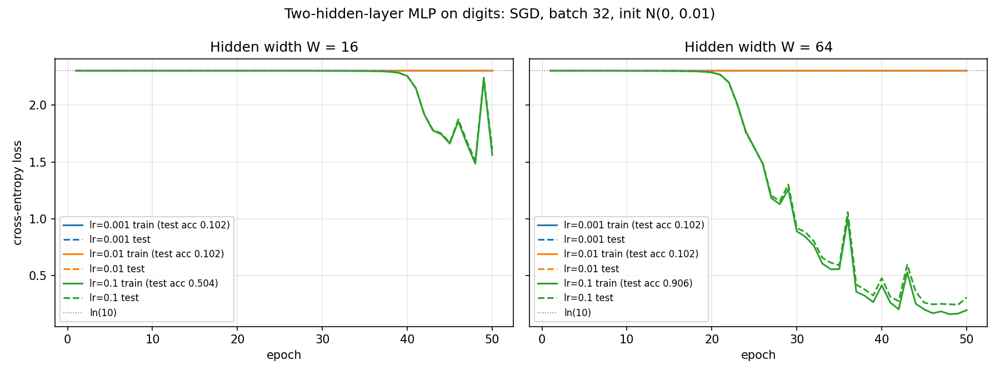
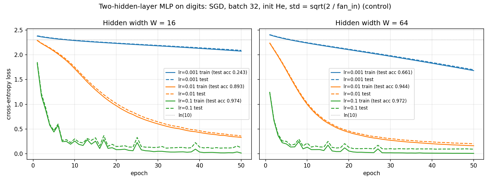

# Lab 2 — A neural network from scratch

## 1. Goal

Build a two-hidden-layer neural network in plain NumPy (no autograd), derive
and implement backpropagation by hand, prove the gradients are correct with a
numerical gradient check, train it on the digits dataset for a grid of
learning rates and widths, and measure how the time of one training step
splits between the forward and the backward pass.

| Learning outcome | Evidence in this report |
|---|---|
| Design a two-hidden-layer network with dimensionally correct parameters | §2.2 Design (shapes, parameter counts); `results/design.txt` |
| Implement forward propagation, cross-entropy loss and backpropagation from scratch | §2.3 Forward and loss, §2.4 Gradient derivation; `src/mlp.py`; §3.1 checks (`results/forward_loss_check.txt`) |
| Validate analytical gradients with numerical gradient checking | §3.2 Gradient check — **PASSED 10/10 (W=16) and 9/10 (W=64)**; `results/gradcheck.txt` |
| Compare learning rates, hidden widths, accuracy, and forward/backward timing | §3.3 Training (`results/loss_curves.png`, `results/final_accuracy.csv`); §3.4 Timing (`results/timing.txt`) |

## 2. Method

**Hardware and software.** AMD Ryzen 7 2700X (8 cores / 16 threads, 512 KB L2
per core), 16 GB RAM, Windows 10 Pro 19045, CPU only. Python 3.11.8, NumPy
1.26.4 (OpenBLAS), venv from Lab 1. Everything is float64. Seed 42 everywhere.

### 2.1 Data (`src/data.py` → `results/dataset.txt`)

`load_digits`: 1 797 grayscale 8×8 images → 64 features with values 0–16.
Inputs divided by 16 → [0, 1]. Labels one-hot encoded to 10 columns.
Split 70/30, stratified, `random_state=42` → **1 257 train / 540 test**; every
class is 9.7–10.2 % of both parts.

### 2.2 Design (`src/design.py` → `results/design.txt`)

```
X (B,64) ─ @W1 (64,W) + b1 (W,) ─► Z1 (B,W) ─ ReLU ─► A1 (B,W)
A1       ─ @W2 (W,W)  + b2 (W,) ─► Z2 (B,W) ─ ReLU ─► A2 (B,W)
A2       ─ @W3 (W,10) + b3 (10,)─► Z3 (B,10) ─ softmax ─► P (B,10)
```

The shapes follow from matrix multiplication: the inner dimension of each
product must match (64 with 64, W with W), the outer dimensions give the next
layer's width. Each bias has one entry per neuron of its layer and is
broadcast over the batch.

| | W1 | b1 | W2 | b2 | W3 | b3 | **total** | float64 bytes |
|---|---|---|---|---|---|---|---:|---:|
| W = 16 | 64×16 = 1 024 | 16 | 16×16 = 256 | 16 | 16×10 = 160 | 10 | **1 482** | 11.6 KB |
| W = 64 | 64×64 = 4 096 | 64 | 64×64 = 4 096 | 64 | 64×10 = 640 | 10 | **8 970** | 70.1 KB |

**Initialisation:** weights ~ N(0, 0.01), read as standard deviation 0.01
(the usual `0.01 · randn`; measured std 0.0096–0.0110); biases = 0.

### 2.3 Forward and loss (`src/mlp.py`)

Forward is exactly the diagram above. Softmax subtracts the row maximum before
`exp` (prevents overflow; the result is unchanged because the shift cancels in
the ratio). Cross-entropy is the batch mean
`L = −(1/B) Σ_i Σ_k Y_ik · log P_ik` (a 1e-12 guard inside the log).

### 2.4 Gradient derivation (chain rule)

Going backward through the graph, using `dX` for ∂L/∂X:

1. **Softmax + cross-entropy together.** For one row,
   `∂L/∂Z3_k = P_k − Y_k` (the softmax Jacobian multiplied by `−Y/P` collapses
   to this because ΣY = 1). With the batch mean: **`dZ3 = (P − Y) / B`**.
2. **Linear layer `Z = A W + b`.** Each `Z_ij = Σ_k A_ik W_kj + b_j`, so
   **`dW = Aᵀ dZ`**, **`db = Σ_rows dZ`**, and the gradient passed to the
   previous layer is **`dA = dZ Wᵀ`**.
3. **ReLU `A = max(Z, 0)`.** Derivative is 1 where `Z > 0`, 0 otherwise:
   **`dZ = dA ⊙ [Z > 0]`**.

Applied layer by layer:

```
dZ3 = (P − Y)/B           dW3 = A2ᵀ dZ3   db3 = Σ dZ3
dA2 = dZ3 W3ᵀ   dZ2 = dA2 ⊙ [Z2>0]   dW2 = A1ᵀ dZ2   db2 = Σ dZ2
dA1 = dZ2 W2ᵀ   dZ1 = dA1 ⊙ [Z1>0]   dW1 = Xᵀ dZ1    db1 = Σ dZ1
```

`dX` is not needed (inputs are not trained), so backward has 5 matrix products
against forward's 3. Shapes check: `dW1 = Xᵀ(64,B)·dZ1(B,W) → (64,W)` = shape of W1,
and the same for every parameter. The update is plain SGD, `θ ← θ − lr · dθ`.

### 2.5 Gradient check (`src/gradcheck.py`)

Central difference `(L(w+h) − L(w−h)) / 2h` with `h = 1e-5` on a batch of 32
training rows; relative error `|a − n| / max(|a|, |n|)`; pass if < 1e-6 for at
least 9 of 10 randomly chosen weights (drawn from W1, W2, W3). Weights with an
exactly zero gradient (pixels that are always 0, inactive ReLUs) are not
sampled — they would pass trivially (0 = 0) and prove nothing.

The graded check is done on the network **after 50 epochs of SGD (lr 0.1)**.
The same check at the N(0, 0.01) initialisation is kept as a diagnostic, and
for both points every weight of the network is swept once (§3.2 explains why).

### 2.6 Training (`src/train.py`)

Mini-batch SGD, batch 32 (40 batches per epoch, last one 9 rows), 50 epochs,
training set reshuffled every epoch. Grid: lr ∈ {0.001, 0.01, 0.1} ×
W ∈ {16, 64}. Each configuration starts from the same seed, so all runs with
the same width start from the same weights. After every epoch the full
train and test loss and accuracy are logged (`results/training_log.csv`,
console output in `results/training_stdout.txt`). Two full runs of the grid
gave bit-identical results.

**Control run** (`python train.py --init he`, files with `_he` suffix): the
same grid with He initialisation, std = √(2 / fan_in), to test whether the
behaviour in §3.3 comes from the initialisation or from the code.

### 2.7 Timing (`src/timing.py`)

Forward (`forward`) and backward (`backward`, given the forward cache) timed
separately with `time.perf_counter`: 10 warm-up calls, then **100 timed
calls, median** (p95 and all 100 values in `results/timing_raw.json`). Two
batch sizes: 32 (one training step) and 1 257 (full training set). He-scaled
weights are used so ReLU masks are realistic. Alongside: the FLOP count of
the matrix products (2·m·k·n each), and the time of the matrix products of
each pass on their own, giving their share of the pass.

## 3. Results

### 3.1 Forward shape and loss sanity checks (`results/forward_loss_check.txt`)

| Width | Input | Output P | max \|row sum − 1\| | Result |
|---|---|---|---:|---|
| 16 | (32, 64) | (32, 10) | 2.2e-16 | PASS |
| 16 | (1257, 64) | (1257, 10) | 4.4e-16 | PASS |
| 16 | (540, 64) | (540, 10) | 2.2e-16 | PASS |
| 64 | (32, 64) | (32, 10) | 3.3e-16 | PASS |
| 64 | (1257, 64) | (1257, 10) | 3.3e-16 | PASS |
| 64 | (540, 64) | (540, 10) | 4.4e-16 | PASS |

Untrained loss: **2.3026** on train and test for both widths,
|loss − ln 10| ≤ 8.3e-6. With weights of std 0.01 the logits are ≈ 0
(std 2e-5 – 8e-5), softmax gives 0.1 to every class, and −ln 0.1 = ln 10 —
the network "knows nothing", which is exactly what an untrained model should
report.

### 3.2 Gradient check (`results/gradcheck.txt`, `results/gradcheck.csv`)

**Graded check — after 50 epochs, 10 random weights:**

| W = 16 | analytic | numerical | rel. error | | W = 64 | analytic | numerical | rel. error |
|---|---:|---:|---:|---|---|---:|---:|---:|
| W1 (12,15) | −5.221565e-06 | −5.221568e-06 | 6.0e-07 | | W1 (21,42) | 2.026735e-02 | 2.026735e-02 | 1.9e-10 |
| W2 (4,0) | 2.962144e-02 | 2.962144e-02 | 1.8e-11 | | W2 (40,56) | −1.794651e-02 | −1.794651e-02 | 1.3e-10 |
| W1 (2,13) | −7.714779e-03 | −7.714779e-03 | 7.6e-10 | | W1 (3,52) | 1.663392e-02 | 1.663392e-02 | 3.2e-10 |
| W2 (11,12) | −1.290045e-03 | −1.290045e-03 | 3.8e-09 | | W2 (50,6) | 1.739466e-03 | 1.739466e-03 | 1.3e-09 |
| W2 (0,11) | 1.015832e-02 | 1.015832e-02 | 1.9e-10 | | W2 (35,9) | −2.095234e-05 | −2.095234e-05 | 1.0e-08 |
| W1 (58,3) | 1.103587e-04 | 1.103587e-04 | 3.4e-08 | | W2 (24,61) | 1.206954e-07 | 1.206958e-07 | **3.7e-06** |
| W3 (8,8) | 1.649982e-02 | 1.649982e-02 | 2.5e-11 | | W3 (10,8) | 4.575822e-02 | 4.575822e-02 | 3.7e-11 |
| W1 (41,5) | 7.507863e-04 | 7.507863e-04 | 1.4e-08 | | W2 (1,23) | 1.591085e-03 | 1.591085e-03 | 4.7e-10 |
| W1 (38,1) | 9.261879e-04 | 9.261879e-04 | 6.7e-09 | | W1 (62,3) | 1.854662e-03 | 1.854662e-03 | 1.6e-09 |
| W1 (13,4) | 1.103975e-02 | 1.103975e-02 | 1.3e-09 | | W1 (22,28) | 4.245745e-04 | 4.245745e-04 | 4.1e-09 |
| **pass** | | | **10/10** | | **pass** | | | **9/10** |

**GRADIENT CHECK PASSED for both widths.** The single miss (W = 64, W2 (24,61))
is a weight whose gradient is only 1.2e-7: its absolute error is 4.5e-13,
the same rounding noise as every other row.

**Sweep over every weight with a non-zero gradient:**

| Point | W | batch loss | weights | median \|g\| | median abs. err | median rel. err | rel. err < 1e-6 | for \|g\| < 1e-5 | 1e-5 ≤ \|g\| < 1e-4 | \|g\| ≥ 1e-4 |
|---|---|---:|---:|---:|---:|---:|---:|---:|---:|---:|
| trained | 16 | 1.675 | 876 | 6.5e-03 | 5.7e-12 | 7.3e-10 | **99.3 %** | 60 % (15) | 100 % (60) | 100 % (801) |
| trained | 64 | 0.092 | 6 803 | 1.5e-03 | 1.2e-12 | 8.0e-10 | **96.8 %** | 67 % (563) | 100 % (970) | 99.3 % (5 270) |
| init | 16 | 2.303 | 896 | 1.5e-05 | 9.9e-12 | 7.7e-07 | 55.2 % | 19 % (362) | 79 % (505) | 90 % (29) |
| init | 64 | 2.303 | 5 946 | 1.6e-05 | 8.8e-12 | 5.3e-07 | 64.3 % | 24 % (2 370) | 90 % (3 104) | 100 % (472) |

**Why the check is graded at the trained point.** The first attempt, at the
N(0, 0.01) initialisation, gave 6/10 and 7/10. The sweep shows why this is
not a bug in the derivation:

* The **absolute** error is ≈ 1e-11 at both points, independent of the
  gradient. That is the rounding limit of a central difference in float64:
  the loss (≈ 2.3) is known to ~1e-16 relative, so `(L+ − L−)/2h` carries an
  error of about 2.3·1e-16 / 1e-5 ≈ 1e-11 whatever the true slope is.
* At initialisation the gradients themselves are tiny — median 1.5e-5 — because
  with std-0.01 weights the activations shrink by 15–50× per hidden layer (§3.3).
  1e-11 / 1e-5 = 1e-6, right at the threshold, so roughly half the weights
  fail on noise alone. One init sample (W1 (43,9), error 7e-3) is also a
  weight whose ±1e-5 nudge flipped a ReLU from on to off — the loss has a kink
  there and no finite difference is valid across it.
* The pass rate rises with gradient size at both points, and in the trained
  network, where gradients are 1e-3–1e-2, 99–100 % of all weights with
  |g| ≥ 1e-5 pass, with median relative error ≈ 8e-10.

So the analytic gradients match the numerical ones to 9–10 significant
digits wherever the numerical method itself is accurate enough to tell.

### 3.3 Training (`results/loss_curves.png`, `results/final_accuracy.csv`)



| | lr = 0.001 | lr = 0.01 | lr = 0.1 |
|---|---|---|---|
| **W = 16** — final test acc | 0.1019 | 0.1019 | **0.5037** |
| — final train / test loss | 2.3025 / 2.3025 | 2.3025 / 2.3025 | 1.5625 / 1.6117 |
| **W = 64** — final test acc | 0.1019 | 0.1019 | **0.9056** |
| — final train / test loss | 2.3025 / 2.3025 | 2.3023 / 2.3023 | 0.1983 / 0.3096 |
| Time for 50 epochs (W=16 / W=64) | 0.41 s / 0.76 s | 0.41 s / 0.77 s | 0.41 s / 0.72 s |

(In the plot the lr = 0.001 and lr = 0.01 lines lie exactly on top of each
other at ln 10.)

**What happens.** With N(0, 0.01) initialisation the network starts on a
**plateau**: the loss stays at ln 10 and accuracy at 10 % (chance) until the
weights have grown enough for the signal to pass through all three layers.

* **lr = 0.001 and 0.01 never leave the plateau in 50 epochs** — loss changes
  in the 4th decimal, accuracy stays at chance for both widths.
* **lr = 0.1 escapes it**: W = 64 at epoch ~20 (test acc 0.25 at epoch 20,
  0.66 at 30, 0.85 at 40, **0.906** at 50); W = 16 only at epoch ~38 and
  reaches **0.504** by epoch 50, still falling steeply.
* After the plateau the curves are noisy (spikes at epochs 29, 36, 43 for
  W = 64; 46, 49 for W = 16): lr = 0.1 is at the edge of stable steps for
  this network.
* **Width:** the wider network escapes about twice as early and ends far
  better. With more hidden units the products that carry the signal (and the
  gradient) through the layers sum over more terms, so they start larger —
  measured std of the second hidden layer at init is 1.2e-3 for W = 64 vs
  3.9e-4 for W = 16.
* Train and test loss stay close in every run (largest gap 0.11 for W = 64,
  lr = 0.1), so no overfitting within 50 epochs.

**Why the plateau: the initialisation.** Measured at init:

| | std A1 | std A2 | std logits Z3 | mean \|dW1\| | mean \|dW2\| | mean \|dW3\| |
|---|---:|---:|---:|---:|---:|---:|
| N(0, 0.01), W=16 | 1.9e-2 | 3.9e-4 | 1.9e-5 | 6.3e-6 | 9.9e-6 | 1.1e-5 |
| N(0, 0.01), W=64 | 1.8e-2 | 1.2e-3 | 7.6e-5 | 1.0e-5 | 8.9e-6 | 2.8e-5 |
| He, W=16 | 0.33 | 0.24 | 0.42 | 1.0e-2 | 6.8e-3 | 8.2e-3 |
| He, W=64 | 0.32 | 0.38 | 0.42 | 4.4e-3 | 3.6e-3 | 1.2e-2 |

Each std-0.01 layer multiplies the signal by about 0.01·√fan_in (0.04–0.08),
so after two hidden layers the logits are ~1e-5 and the softmax output does not
depend on the input. Backward goes through the same small weights in reverse,
so every gradient is ~1e-5: with lr = 0.001 a weight moves ~1e-8 per step, and
2 000 steps (40 batches × 50 epochs) are not enough to break out.

**Control run with He init** (`results/loss_curves_he.png`,
`results/final_accuracy_he.csv`) — identical code, only the weight scale
changed:



| Final test acc | lr = 0.001 | lr = 0.01 | lr = 0.1 |
|---|---:|---:|---:|
| W = 16 | 0.2426 | 0.8926 | **0.9741** |
| W = 64 | 0.6611 | 0.9444 | **0.9722** |

Every configuration starts learning from the first epoch, the ordering
lr 0.1 > 0.01 > 0.001 and W 64 ≥ 16 is kept, and the best accuracy rises to
97 %. This confirms that the plateau in the required runs is caused by the
N(0, 0.01) scale, not by an error in forward, backward or the training loop.

**Recorded final test accuracy (required configuration):** best is
**W = 64, lr = 0.1 → 0.9056**; W = 16, lr = 0.1 → 0.5037; all others 0.1019.

### 3.4 Forward vs backward timing (`results/timing.txt`, `results/timing.csv`)

| W | batch | forward, median | backward, median | backward / forward | matmul FLOP fwd → bwd | FLOP ratio | matmul share of fwd / bwd time |
|---|---:|---:|---:|---:|---|---:|---|
| 16 | 32 | 43.9 µs | 50.4 µs | **1.15** | 0.09 → 0.12 MFLOP | 1.29 | 31 % / 41 % |
| 64 | 32 | 74.2 µs | 98.9 µs | **1.33** | 0.57 → 0.87 MFLOP | 1.54 | 50 % / 61 % |
| 16 | 1257 | 522 µs | 474 µs | 0.91 | 3.6 → 4.7 MFLOP | 1.29 | 40 % / 58 % |
| 64 | 1257 | 2 104 µs | 1 940 µs | 0.92 | 22.2 → 34.1 MFLOP | 1.54 | 22 % / 43 % |

Repeated runs: the batch-32 rows are stable to ±10 % (W=64: 1.33–1.34 in every
run). The W=64, batch-1257 ratio varied between 0.92 and 1.31 across
eight runs, with 1 or 2 BLAS threads alike.

**Which dominates: the backward pass**, for the case that matters in training
(batch 32): 1.15× forward for W = 16 and 1.33× for W = 64. One SGD step
(forward + backward) is 94 µs for W = 16 and 173 µs for W = 64.

**Link to matrix multiplication.** Both passes are built from matrix
products of the same sizes:

* Forward: 3 products — `X W1`, `A1 W2`, `A2 W3`.
* Backward: those same 3 shapes again as weight gradients (`Xᵀ dZ1`,
  `A1ᵀ dZ2`, `A2ᵀ dZ3` — each has the same m·k·n as its forward product), plus
  2 more to send the error back to the previous layer (`dZ3 W3ᵀ`, `dZ2 W2ᵀ`).
  The input gradient `dZ1 W1ᵀ` is skipped because X is not trained.

So backward does `1 + (layers 2 and 3)/(all layers)` times the forward
multiply work: 1.29× for W = 16 and 1.54× for W = 64 (the first layer, which
has no backward input product, is a smaller fraction of the work in the wider
network). In a deeper network, or one that also needs `dX`, this tends to 2×.
The measured time ratio follows the FLOP ratio more closely the larger the
share of time spent in matmuls: at W = 64, batch 32, matmuls are 50–61 % of
each pass and the time ratio (1.33) is close to the FLOP ratio (1.54); at
W = 16 the matrices are tiny (16×16), matmuls are only 31–41 % of the time,
and fixed per-call overhead (NumPy dispatch, ReLU masks, softmax, bias sums,
memory allocation) flattens the ratio to 1.15.

**At batch 1 257 the picture changes.** The activation arrays become
1 257 × 64 × 8 B ≈ 630 KB, larger than the 512 KB L2 cache of a core.
Forward time per row rises from 1.1 µs at batch 512 (256 KB arrays) to
1.6–1.7 µs from batch 900 up, and matmuls drop to 22 % of the forward pass:
the element-wise work (ReLU, bias add, softmax `exp`, allocating new arrays)
is limited by memory traffic, not arithmetic. Backward then is no longer
reliably slower, and its ratio jumps from run to run. This is outside
training (which uses batch 32) but shows that "backward ≈ 1.5× forward" holds
only while the step is compute-bound by matrix multiplication.

## 4. Conclusions

* The network 64 → W → W → 10 has 1 482 (W = 16) or 8 970 (W = 64)
  parameters; all shapes follow from the matrix products, and forward
  returns valid probability rows of shape (batch, 10).
* The untrained loss is ln 10 = 2.3026, as expected for uniform predictions.
* The hand-derived gradients (`dZ3 = (P−Y)/B`, `dW = Aᵀ dZ`, `dA = dZ Wᵀ`,
  ReLU mask) pass the numerical check: 10/10 and 9/10 weights below 1e-6,
  99 % of all weights with non-negligible gradients. At initialisation
  float64 rounding (≈ 1e-11) is too large relative to the ≈ 1e-5 gradients
  for the 1e-6 criterion to be meaningful.
* With the prescribed N(0, 0.01) init only lr = 0.1 learns within 50 epochs;
  W = 64 reaches **90.6 %** test accuracy, W = 16 50.4 %. lr 0.001 and 0.01
  stay at chance. The cause is vanishing signal from too-small weights,
  confirmed by the He-init control (97 %, all learning rates learn).
* The backward pass dominates a training step (1.15–1.33× forward at batch
  32) because it performs 5 matrix multiplications against 3 — 1.29–1.54× the
  FLOPs. The wider the layers, the more time goes to matmuls and the closer
  the time ratio gets to the FLOP ratio.

## 5. Reproduce

```powershell
cd lab02\src
..\..\.venv\Scripts\python data.py                 # results/dataset.txt
..\..\.venv\Scripts\python design.py               # results/design.txt
..\..\.venv\Scripts\python check_forward_loss.py   # results/forward_loss_check.txt
..\..\.venv\Scripts\python gradcheck.py            # results/gradcheck.{txt,csv}
..\..\.venv\Scripts\python train.py                # loss_curves.png, training_log.csv, final_accuracy.csv
..\..\.venv\Scripts\python train.py --init he      # *_he control files
..\..\.venv\Scripts\python timing.py               # results/timing.{txt,csv}, timing_raw.json
```
