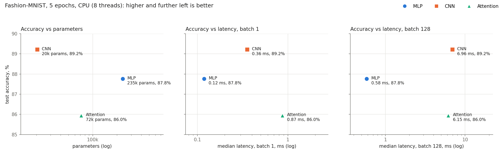

# Lab 3 — Architectures and their costs

## 1. Goal

Build three Fashion-MNIST classifiers from different architecture families (MLP, CNN, Transformer
encoder on image patches), count their parameters and FLOPs by hand and with profiling tools,
measure inference latency at batch 1 and batch 128, train all three under the same recipe, and
decide which architecture gives the most accuracy for its cost.

| Learning outcome | Evidence in this report |
|---|---|
| Implement comparable MLP, CNN, and attention architectures in PyTorch | §2.2 Models; `src/models.py`; `results/params.txt` |
| Calculate parameters and representative FLOPs by hand and compare with profiling tools | §3.1 Parameters (hand = torchinfo for all three); §3.2 FLOPs (hand vs `thop.profile`, every gap explained); `results/flops.txt` |
| Measure inference latency for different batch sizes using a repeatable protocol | §2.4 Protocol; §3.3 Latency (3 passes agree); `results/latency.txt` |
| Explain architecture trade-offs using accuracy, parameter count, latency, and access patterns | §3.4 Accuracy; §3.5 Trade-off plots and access patterns; `results/tradeoffs.png`, `results/tradeoffs.txt` |

## 2. Method

**Hardware and software.** AMD Ryzen 7 2700X (8 cores / 16 threads, 512 KB L2 per core,
16 MB L3), 16 GB RAM, Windows 10 Pro 19045, CPU only. Python 3.11.8, PyTorch 2.3.1+cpu,
torchvision 0.18.1, torchinfo 1.8.0, thop 0.1.1. float32, 8 intra-op threads (PyTorch default),
seed 42.

### 2.1 Data (`src/data.py` → `results/dataset.txt`)

`torchvision.datasets.FashionMNIST`, transform `ToTensor()` + `Normalize((0.2860,), (0.3530,))`.
The official 60k training set is split with `random_split` (generator seed 42) into
**55 000 train / 5 000 validation**; the official **10 000 test** set is used once, after
training. Batch size 128 → 430 training batches per epoch. Checks: no index overlap between train
and validation; normalised pixels have mean 0.003 and std 1.001 (so the given constants fit the
data); every class has 445–548 validation and exactly 1 000 test images, so plain accuracy is a
fair metric.

### 2.2 Models (`src/models.py` → `results/params.txt`)

All three take `(B, 1, 28, 28)` and return `(B, 10)` logits.

* **MLP:** Flatten 784 → Linear 256 → ReLU → Linear 128 → ReLU → Linear 10.
* **CNN:** Conv2d(1,16,3,p=1) → ReLU → MaxPool2 → Conv2d(16,32,3,p=1) → ReLU → MaxPool2 →
  Flatten → Linear(32·7·7, 10).
* **Attention:** the image is cut into a 4 × 4 grid of 16 non-overlapping 7 × 7 patches
  (row-major; a test checks that patch 6 is rows 7–13, columns 14–20), each patch is flattened to
  49 values and projected Linear 49 → 64. Two `nn.TransformerEncoderLayer`s (d_model 64, 4 heads,
  dim_feedforward 128, ReLU, dropout 0.1, post-norm, `batch_first=True`), mean pool over the 16
  tokens, Linear 64 → 10.

**One addition to the specification: a learned position embedding** (16 × 64 = 1 024 parameters,
1.4 % of the model) added after the patch projection. The manual does not mention positions, but
self-attention followed by mean pooling is invariant to the order of the patches, so without it the
model could not tell the top of an image from the bottom. This is the standard ViT design.

**Parameter-size target.** The manual asks for "similar size, target 100k–150k parameters", but
the layer sizes it prescribes give 235k / 20k / 72k (§3.1). The architectures were kept exactly as
specified; the 11× spread in size is part of what the trade-off analysis in §3.5 explains.

### 2.3 FLOP counting (`src/flops.py` → `results/flops.txt`, `results/flops.csv`)

Hand counts use the Ch. 4 formulas for one image (batch 1). 1 MAC = 2 FLOPs. Only matrix
multiplications are counted; bias adds, ReLU, max-pool, softmax, LayerNorm and residual adds are
left out, as in the formulas.

* Linear: `2 · in · out` (× number of rows, e.g. 16 tokens).
* Conv2d: `2 · K · K · C_in · C_out · H_out · W_out`.
* Encoder layer (seq = 16, d = 64, d_ff = 128): QKV `2·seq·d·3d`, scores `2·seq²·d`,
  softmax·V `2·seq²·d`, output projection `2·seq·d·d`, FFN `2·seq·d·d_ff` twice.

`thop.profile` reports MACs, so its numbers are doubled before comparing. Because the first
comparison showed a large gap for the attention model, two extra measurements were made to locate
it: thop with PyTorch's Transformer "fast path" disabled (`torch.backends.mha.set_fastpath_enabled(False)`),
and the same plus a custom thop rule for `nn.MultiheadAttention`. PyTorch's own
`torch.utils.flop_counter.FlopCounterMode` was run as an independent second tool.

### 2.4 Latency protocol (`src/latency.py` → `results/latency.txt`, `latency.csv`, `latency_raw.json`)

* `model.eval()` and `torch.inference_mode()`; real test images (the first 128; batch 1 is the
  first of them).
* 10 warm-up forward passes, then each forward call is timed with `time.perf_counter`.
* **Batch 1: median of 100 runs. Batch 128: median of 20 runs.** p10 and p90 are reported too.
* The whole protocol is repeated in **3 passes**, with the model order rotated each pass, to check
  that the medians are repeatable. The table reports the last pass and lists all three medians.
* Untrained weights are used: the work done in a forward pass does not depend on the weight values.

### 2.5 Training (`src/train.py` → `results/accuracy.txt`, `accuracy.csv`, `training_log.csv`)

Adam, lr 1e-3, batch 128, 5 epochs, cross-entropy. Each model is trained with the same seed and
therefore sees exactly the same batch order. Validation loss and accuracy are logged after every
epoch; test accuracy is measured once, after epoch 5.

### 2.6 Plots (`src/plots.py` → `results/tradeoffs.png`, `tradeoffs.txt`, `tradeoffs.csv`)

Test accuracy against parameter count, batch-1 latency and batch-128 latency (log x-axes). The
same script adds the access-pattern metrics used in §3.5: MACs per weight (how often each weight is
reused per image) and achieved GFLOP/s (hand FLOPs ÷ median latency).

## 3. Results

### 3.1 Parameters (`results/params.txt`)

| Model | torchinfo | By hand | Where the parameters are |
|---|---:|---:|---|
| MLP | **235 146** | 235 146 | 85 % in the first layer: 784·256 + 256 = 200 960 |
| CNN | **20 490** | 20 490 | conv1 160, conv2 4 640, final Linear 1568→10 15 690 (77 %) |
| Attention | **71 818** | 71 818 | patch projection 3 200, positions 1 024, 2 × encoder layer 33 472, head 650 |

One encoder layer: QKV in-projection 3·64·64 + 3·64 = 12 480, out-projection 4 160, FFN
64·128 + 128 + 128·64 + 64 = 16 576, two LayerNorms 256 → 33 472. torchinfo agrees with the hand
count for all three models. Note that torchinfo shows *0.00 mult-adds* for the attention model:
it does not see the work inside `nn.MultiheadAttention` either (see §3.2).

### 3.2 FLOPs: hand calculation vs `thop.profile` (`results/flops.txt`)

**One layer of each type, by hand (batch 1):**

| Layer | Formula | FLOPs |
|---|---|---:|
| Linear, MLP fc1 784 → 256 | 2 · 784 · 256 | 401 408 |
| Conv2d, CNN conv2 3×3, 16 → 32, output 14×14 | 2 · 3 · 3 · 16 · 32 · 14 · 14 | 1 806 336 |
| Attention, one encoder layer (seq 16, d 64, d_ff 128) | sum of the rows below | **1 114 112** |
| — QKV projections | 2 · 16 · 64 · 3 · 64 | 393 216 |
| — attention scores QKᵀ | 2 · 16² · 64 | 32 768 |
| — softmax(·) × V | 2 · 16² · 64 | 32 768 |
| — output projection | 2 · 16 · 64 · 64 | 131 072 |
| — FFN up + down | 2 · 2 · 16 · 64 · 128 | 524 288 |

conv2 has only 4 640 parameters but costs 4.5× more FLOPs than the 200k-parameter fc1, because
each of its weights is applied at all 196 output positions.

**Whole model, hand vs tools (FLOPs per image):**

| Model | Hand | thop × 2 (default) | thop × 2, fast path off | thop × 2, fast path off + MHA rule | FlopCounterMode, fast path off |
|---|---:|---:|---:|---:|---:|
| MLP | 469 504 | 469 504 (1.000) | 469 504 | 469 504 | 469 504 |
| CNN | 2 063 488 | 2 063 488 (1.000) | 2 063 488 | 2 063 488 | 2 063 488 |
| Attention | 2 329 856 | **101 632 (0.044)** | 1 182 976 (0.508) | 2 362 624 (1.014) | 2 198 784 (0.944) |

**MLP and CNN match exactly.** thop counts `in_features` MACs per output element for Linear and
`C_in · K · K` MACs per output element for Conv2d, exactly the Ch. 4 formulas, and it also ignores
the bias. ReLU and MaxPool are registered as zero-op modules, matching the hand count.

**The attention model is undercounted 23×.** thop works by attaching a forward hook to every module
whose *exact* type is in its rule table. Two things defeat it here:

1. **PyTorch's fast path.** thop runs the model in `eval()` under `torch.no_grad()`. Under those
   conditions `nn.TransformerEncoderLayer` does not call its sub-modules at all. It runs the whole
   layer as one fused native kernel (`torch._transformer_encoder_layer_fwd`). None of the hooks on
   `linear1`, `linear2`, `norm1`, `norm2` fire, so thop sees only the patch projection (100 352)
   and the head (1 280). `FlopCounterMode` sees the same 101 632, because it has no rule for the
   fused kernel either.
2. **No rule for `nn.MultiheadAttention`.** With the fast path disabled the FFN and LayerNorm
   hooks fire (0.508 × hand), but QKV, QKᵀ, softmax·V and the output projection still count as
   zero. The QKV weights are a raw parameter used inside `F.multi_head_attention_forward`, and
   `out_proj` is an `NonDynamicallyQuantizableLinear`, a *subclass* of `nn.Linear` that thop's
   exact-type lookup does not match.

A short custom thop rule for `nn.MultiheadAttention` (`count_mha` in `src/flops.py`;
MACs = `seq·d·3d + 2·seq²·d + seq·d·d` per image) closes the gap: **1.014 × hand**. The remaining
+32 768 FLOPs are exactly the four LayerNorms, which thop counts and the hand formula deliberately
omits: thop charges 2 ops per element, doubled for the affine scale and shift, over 16 × 64
elements = 4 096 "MACs" per LayerNorm → 8 192 FLOPs × 4.
`FlopCounterMode` with the fast path off is 131 072 short of the hand count. That is exactly QKᵀ
and softmax·V of both layers, because on CPU the attention core runs through the fused
scaled-dot-product-attention kernel, for which this PyTorch version has no FLOP formula.

Takeaway: the profilers are reliable for Linear and Conv2d but silently drop attention. A
transformer FLOP number from a tool should be checked against the hand formula before it is used.

### 3.3 Inference latency (`results/latency.txt`)

| Model | Batch | Runs | Median ms | p10 ms | p90 ms | ms per image | Images/s | Medians of the 3 passes, ms |
|---|---:|---:|---:|---:|---:|---:|---:|---|
| MLP | 1 | 100 | **0.119** | 0.117 | 0.122 | 0.119 | 8 435 | 0.117 0.122 0.119 |
| MLP | 128 | 20 | **0.580** | 0.562 | 0.643 | 0.0045 | 220 709 | 0.568 0.596 0.580 |
| CNN | 1 | 100 | **0.355** | 0.342 | 0.400 | 0.355 | 2 814 | 0.349 0.426 0.355 |
| CNN | 128 | 20 | **6.96** | 6.42 | 8.28 | 0.054 | 18 381 | 6.55 6.64 6.96 |
| Attention | 1 | 100 | **0.869** | 0.779 | 1.039 | 0.869 | 1 151 | 0.799 0.799 0.869 |
| Attention | 128 | 20 | **6.15** | 5.81 | 6.90 | 0.048 | 20 828 | 6.36 6.40 6.15 |

Medians agree across passes to within 10 % in all but one case (CNN batch 1, one pass 20 % higher),
and the ranking of the models never changes. The attention model runs the native fast path here, as in any
`eval()` + no-grad inference.

Latency does not follow FLOPs. The CNN and attention models have almost the same FLOPs (2.06 M vs
2.33 M), but at batch 1 attention is 2.4× slower; at batch 128 it is slightly faster than the
CNN. The MLP has 4.4–5× fewer FLOPs but is 3× faster than the CNN at batch 1 and 12× faster at
batch 128. §3.5 explains why.

### 3.4 Training and test accuracy (`results/accuracy.txt`, `results/training_log.csv`)

| Model | Params | Val acc, epoch 1 | Val acc, epoch 5 | **Test acc** | Test loss | Train time, 5 epochs |
|---|---:|---:|---:|---:|---:|---:|
| MLP | 235 146 | 0.843 | 0.883 | **0.878** | 0.340 | 78 s |
| CNN | 20 490 | 0.848 | 0.897 | **0.892** | 0.298 | 108 s |
| Attention | 71 818 | 0.816 | 0.866 | **0.860** | 0.387 | 123 s |

* **The CNN is the most accurate with the fewest parameters.** Its built-in assumptions (locality
  and weight sharing: a 3×3 filter looks at neighbouring pixels and is reused at every position)
  match the structure of images, so it needs few weights.
* **The MLP is second.** It sees a flat vector of 784 numbers with no notion of which pixels are
  neighbours, and has to learn every connection as a separate weight.
* **The attention model is last and is still improving fastest** (+5 points of validation accuracy
  from epoch 1 to 5, and its training accuracy, 0.867, is the lowest). Transformers have weak image
  priors and need more data or epochs. Five epochs favour the architectures that come with priors.
* Validation and test accuracy differ by 0.5–0.7 points for all three, and training accuracy is
  at most 2 points above validation: no meaningful overfitting in 5 epochs.
* Training time is not proportional to inference cost. The MLP's epoch takes 15.5 s, though its
  forward pass is 12× cheaper than the CNN's, because most of an MLP epoch is spent in the data
  pipeline (decoding PIL images and normalising them one by one in `__getitem__`), not in the model.

### 3.5 Trade-offs and access patterns (`results/tradeoffs.png`, `results/tradeoffs.txt`)



| Model | Test acc | Weights fp32 | FLOPs/image | MACs per weight | GFLOP/s batch 1 | GFLOP/s batch 128 | Batching speed-up per image |
|---|---:|---:|---:|---:|---:|---:|---:|
| MLP | 87.8 % | 918 KB | 0.47 M | **1.0** | 4.0 | **103.6** | **26×** |
| CNN | **89.2 %** | **80 KB** | 2.06 M | **50.4** | **5.8** | 37.9 | 6.5× |
| Attention | 86.0 % | 280 KB | 2.33 M | 16.2 | 2.7 | 48.5 | 18× |

The plots show that no single "cost" axis decides the question: the CNN is best on the parameter
axis, the MLP on both latency axes. The access patterns from Ch. 4.6–4.7 explain the differences.

**MLP: dense, sequential weight streaming with no reuse within one input.** Each weight is read
once and used once per image (1.0 MAC per weight). At batch 1 the 918 KB of weights do not fit in
the 512 KB L2 cache and are streamed from L3 for only 0.47 MFLOP of work, so the pass is limited
by memory bandwidth (4 GFLOP/s). Batching changes the access pattern: each weight loaded is reused
for 128 images, and the layer becomes one large dense GEMM, the operation CPUs and BLAS libraries
are best at. Throughput rises to 104 GFLOP/s, a 26× gain per image. Its access pattern is regular
and predictable, which is why the MLP is the fastest model in absolute terms even though it is the
largest.

**CNN: local sliding-window access with high weight reuse.** A 3×3 filter is applied at all 784
(conv1) or 196 (conv2) positions, so each weight is reused 50 times per image even at batch 1, and
all 80 KB of weights stay in L2. This gives the best batch-1 efficiency (5.8 GFLOP/s) but the
smallest gain from batching (6.5×): the reuse that batching adds was already there. Its cost moves
to the activations: the 16×28×28 and 32×14×14 feature maps (50 KB and 25 KB per image, 9.6 MB at
batch 128) are larger than the weights, and a CPU convolution has to rearrange them into matrices
(im2col-style) before multiplying. At batch 128 the CNN reaches only 38 GFLOP/s, the lowest of the
three.

**Attention: dynamic, data-dependent access spread over many small operations.** The 16×16
attention matrix is computed fresh for every image instead of being a stored weight. One encoder
layer is a chain of small kernels: QKV projection, splitting into 4 heads of 16 dimensions,
QKᵀ, softmax, ×V, output projection, residual add, LayerNorm, FFN, residual add, LayerNorm. Each
reads and writes activations, and softmax and LayerNorm do almost no arithmetic per byte moved.
With only 16 tokens of width 64 the matrices are tiny, so at batch 1 the time goes to launching
kernels and moving data (2.7 GFLOP/s, the worst). At batch 128 the matrices become large enough
to use the cores well (48.5 GFLOP/s, 18×). The quadratic `seq²` term costs little here (6 % of the
layer's FLOPs at seq = 16); it is the fragmentation into many memory-bound steps that is expensive.

**Which architecture is most cost-effective?**

* **The attention model is dominated on every axis.** The CNN is more accurate (+3.2 points),
  3.5× smaller and 2.4× faster at batch 1; the MLP is more accurate and 7× / 11× faster. On 28×28
  images with 16 tokens and 5 epochs, attention pays its overhead without getting the benefits it
  brings on long sequences and large datasets.
* **The CNN is the most cost-effective overall:** the highest accuracy from the smallest model
  (80 KB, 11× smaller than the MLP), with weights that stay in cache and are reused 50 times.
  Whenever memory is the binding budget (mobile, TinyML, where the whole budget is hundreds of KB)
  or accuracy matters most, it is the right choice.
* **The MLP wins when CPU time is the cost:** 3× faster than the CNN at batch 1 and 12× faster at
  batch 128, for 1.4 points less accuracy. For a CPU server with high request volume and batching,
  that is a reasonable price.
* These latency results are for CPU. On a GPU, convolutions and attention gain much more from
  parallel hardware than here, and the latency ranking could change; parameter counts, FLOPs and
  accuracy would not.

## 4. Conclusions

* As specified, the three models have 235k (MLP), 20k (CNN) and 72k (attention) parameters, not
  the 100k–150k the manual targets; hand counts and torchinfo agree exactly. A learned position
  embedding (1 024 parameters) was added to the attention model, which would otherwise be blind to
  patch order.
* Hand FLOPs per image: MLP 0.47 M, CNN 2.06 M, attention 2.33 M. `thop.profile` matches the MLP
  and CNN exactly but reports only 4.4 % of the attention model: PyTorch's fused fast path hides
  the encoder sub-modules from its hooks, and it has no rule for `nn.MultiheadAttention`. With the
  fast path off and a custom MHA rule, thop agrees with the hand count to within 1.4 % (the
  LayerNorms).
* Batch-1 / batch-128 median latency on CPU: MLP 0.12 / 0.58 ms, CNN 0.36 / 6.96 ms, attention
  0.87 / 6.15 ms, repeatable across 3 passes. Latency follows access patterns, not FLOPs.
* After 5 epochs, test accuracy is CNN 89.2 %, MLP 87.8 %, attention 86.0 %.
* The CNN is the most cost-effective architecture (best accuracy, smallest, cache-resident and
  reused weights); the MLP is the right choice when CPU latency or throughput is the cost; the
  attention model is dominated at this scale.

## 5. Reproduce

```powershell
cd lab03\src
..\..\.venv\Scripts\python data.py      # downloads Fashion-MNIST to data/, results/dataset.txt
..\..\.venv\Scripts\python models.py    # results/params.txt
..\..\.venv\Scripts\python flops.py     # results/flops.{txt,csv}
..\..\.venv\Scripts\python latency.py   # results/latency.{txt,csv}, latency_raw.json
..\..\.venv\Scripts\python train.py     # results/accuracy.{txt,csv}, training_log.csv; weights in data/lab03_checkpoints/
..\..\.venv\Scripts\python plots.py     # results/tradeoffs.{png,txt,csv} (needs flops, latency, accuracy)
```
