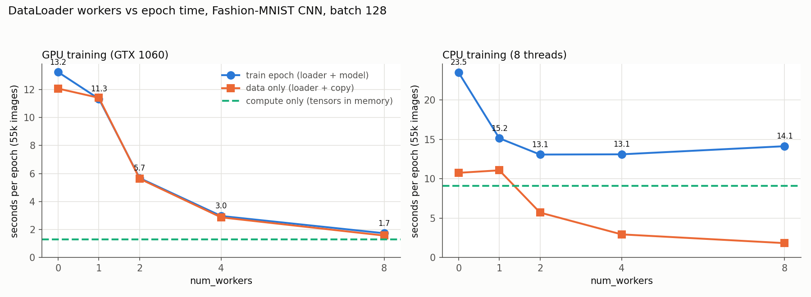
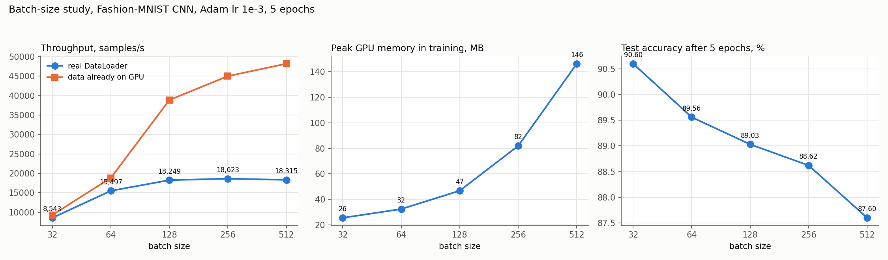
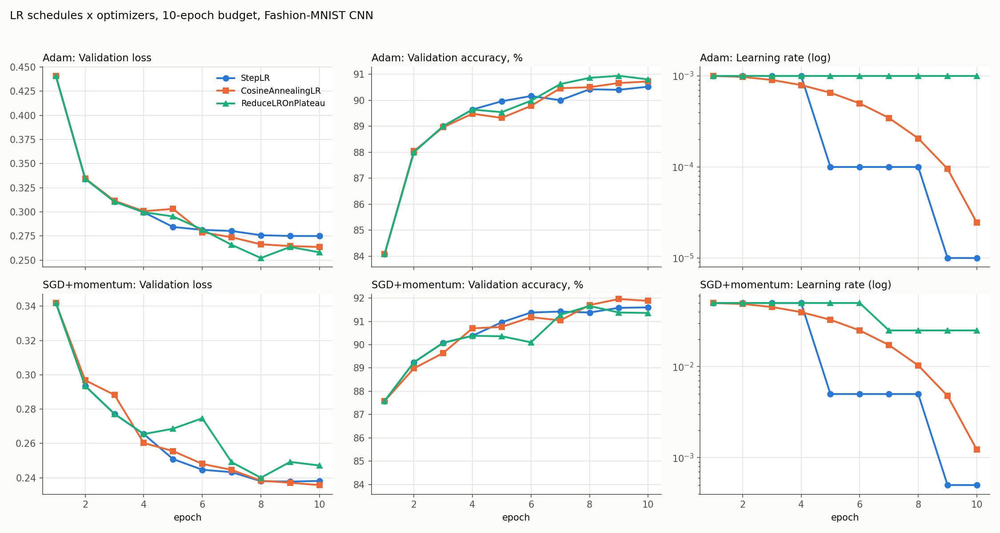
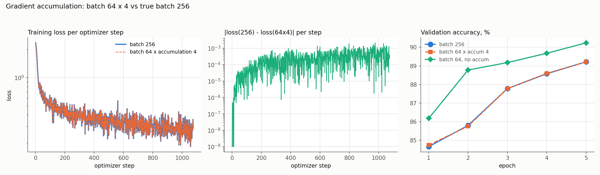
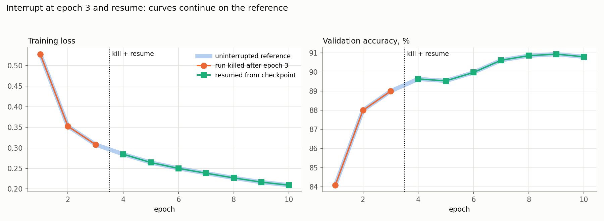

# Lab 6 — Training pipelines and project proposal

## 1. Goal

Turn the best Lab 3 model (the CNN, 89.2 % test accuracy) into a reproducible training pipeline
driven by one YAML config, with seeding, checkpoints and MLflow tracking. Then use the pipeline to
profile an epoch, find the input-pipeline bottleneck, study batch size, LR schedules and
optimizers, emulate a large batch with gradient accumulation, resume training after a kill, and
write the individual project proposal.

| Learning outcome | Evidence in this report |
|---|---|
| Restructure training into a reproducible YAML-driven pipeline | §3.1; `config.yaml`, `src/pipeline.py`, `src/train.py`; identical metrics in 3 independent runs |
| Use MLflow and PyTorch profiling to record experiments and identify bottlenecks | §3.2 profile breakdown (`results/profile.txt`); §3.3 worker study; 30 MLflow runs (`results/mlflow_runs.txt`) |
| Analyze worker count, batch size, throughput, memory, optimizer, and scheduler trade-offs | §3.3–§3.5 study tables and plots |
| Resume interrupted training and prepare a feasible individual project proposal | §3.6 gradient accumulation; §3.7 kill + resume, bit-identical curves; §3.8 `proposal.md` |

## 2. Method

**Hardware.** AMD Ryzen 7 2700X (8 cores / 16 threads), 16 GB RAM, NVIDIA GeForce GTX 1060 3 GB,
Windows 10 Pro 19045.

**Software: the pinned course environment.** Python 3.11.8 and the exact versions from
`requirements.txt` (numpy 1.26.4, pandas 2.2.2, matplotlib 3.9.0, mlflow 2.14.1, ...), installed as
described in the root README (mlflow with `--no-deps`; PyYAML 6.0.4 comes in with mlflow's
dependencies). torch 2.3.1 and torchvision 0.18.1 are the pinned versions in their CUDA 12.1 build
(`2.3.1+cu121`, `0.18.1+cu121` from `download.pytorch.org/whl/cu121`), so that the GPU can be used.
`lab01/src/print_versions.py` lists every package as `OK` except these two, which it marks
`MISMATCH` only because it compares the version strings literally, including the `+cu121` tag.

Two problems of the pinned set showed up and are handled in the code:

* **MLflow store.** The README's dependency range allows SQLAlchemy 2.1 (2.1.9 was installed), and
  mlflow 2.14.1's SQLite backend fails to import with it
  (`cannot import name 'FallbackAsyncAdaptedQueuePool'`). The pipeline therefore uses MLflow's
  file store in `lab06/mlruns/`, which is the default for mlflow 2.x and is already in `.gitignore`.
* **Thread count.** In torch 2.3.1 the DataLoader's pin-memory thread calls
  `torch.set_num_threads(1)` (`torch/utils/data/_utils/pin_memory.py`, line 19), and this setting
  applies to the whole process. After the first GPU loader with workers and `pin_memory=True`, the
  process does all CPU math on **one thread** (checked: 8 threads before, 1 after). A CPU run started
  later in the same process became 2–5× slower. `seed_everything` now restores the original thread
  count (8) at the start of every run, and the CPU measurements run before any GPU loader.

**Data and model.** As in Lab 3: Fashion-MNIST, `ToTensor()` + `Normalize(0.2860, 0.3530)`,
55 000 / 5 000 train/validation split of the official training set (seed 42), official 10 000 test
images used once after training. CNN: Conv(1→16, 3×3) → ReLU → MaxPool → Conv(16→32, 3×3) → ReLU →
MaxPool → Linear(1568→10), 20 490 parameters. Training uses the real `DataLoader` with the
per-image torchvision transform. The validation and test sets are converted to tensors once
(identical values, `x/255` then normalize), so evaluation does not interfere with the input-pipeline
measurements.

**Files.**

| File | Step | What it does |
|---|---|---|
| `config.yaml` | 1 | the single config: seed, determinism, device, paths, data, model, optimizer, scheduler, training, MLflow |
| `src/common.py` | — | config loading and `--set key=value` overrides, seeding and thread reset, result writers, plot style |
| `src/data.py` | 1 | datasets, `DataLoader` with its own seeded sampler generator, tensor loader for compute-only runs |
| `src/models.py` | 1 | the Lab 3 CNN |
| `src/pipeline.py` | 1, 6, 7 | optimizer/scheduler factories, training epoch with gradient accumulation, checkpoints, resume, MLflow tracker |
| `src/train.py` | 1, 7 | CLI: `--config`, `--set`, `--resume` |
| `src/profile_epoch.py` | 2 | `torch.profiler` breakdown of one epoch |
| `src/workers_study.py` | 3 | `num_workers` ∈ {0, 1, 2, 4, 8} on CPU and GPU |
| `src/batch_study.py` | 4 | batch ∈ {32 … 512}, 5 epochs each |
| `src/schedule_study.py` | 5 | {StepLR, Cosine, Plateau} × {Adam, SGD+momentum}, 10 epochs each |
| `src/grad_accum.py` | 6 | batch 64 × 4 accumulation vs batch 256 |
| `src/resume_demo.py` | 7 | kill at epoch 3, resume, compare with an uninterrupted run |
| `src/export_mlflow.py` | — | exports the MLflow runs table to `results/mlflow_runs.{csv,txt}` |
| `proposal.md` | 8 | individual project proposal |

Run from the repository root (each script writes its own `results/*.txt`, `*.csv`, `*.png`):

```bash
python lab06/src/train.py --save-output train_base.txt          # step 1, ~1 min
python lab06/src/train.py --set optim.name=sgd optim.lr=0.05 sched.name=cosine run_name=sgd-cos
python lab06/src/train.py --resume data/lab06_runs/<run>/last.pt  # continue a stopped run
python lab06/src/profile_epoch.py      # step 2, ~17 min (the profiler is slow with num_workers=0)
python lab06/src/workers_study.py      # step 3, ~11 min
python lab06/src/batch_study.py        # step 4, ~4 min
python lab06/src/schedule_study.py     # step 5, ~5 min
python lab06/src/grad_accum.py         # step 6, ~2 min
python lab06/src/resume_demo.py        # step 7, ~3 min
python lab06/src/export_mlflow.py
mlflow ui --backend-store-uri lab06/mlruns   # browse the runs
```

Checkpoints go to `data/lab06_runs/<run_name>/` and the MLflow store to `lab06/mlruns/`; both are
git-ignored, and the exported runs table is committed.

## 3. Results

### 3.1 YAML-driven pipeline [20]

Everything that changes a run lives in `config.yaml`; the scripts hard-code nothing else.
Any key can be overridden from the command line (`--set data.batch_size=256 sched.name=cosine`).
The studies build their variants with the same override function, so every experiment is
"base config + a few named changes".

* **Seed and determinism.** `seed_everything(42)` seeds Python, NumPy, PyTorch CPU and CUDA, sets
  `cudnn.deterministic = True` and `cudnn.benchmark = False`. The split uses its own generator
  (seed 42), and the shuffling sampler gets its own `torch.Generator` (seed 42), separate from the
  generator that seeds the workers. The base run, the `batch-128` run of §3.4 (first 5 epochs) and
  the `resume-reference` run of §3.7 were started separately and produced **identical** train/val
  metrics for every epoch.
* **Checkpoints.** After every epoch `last.pt` is written, and `best.pt` when validation accuracy
  improves. A checkpoint holds the model, optimizer state (Adam moments and step counts), scheduler
  state, sampler-generator state, Torch/CUDA/NumPy/Python RNG states, the full history, the best
  validation accuracy, the config and the MLflow run id. Files are written to `*.tmp` and then
  renamed with `os.replace`, so a crash during saving cannot leave a half-written checkpoint.
* **MLflow.** File store `lab06/mlruns/`, experiment `lab06-fashion-cnn`. Each training run logs
  all 32 config values as **params** (flattened, e.g. `optim.lr`), per-epoch **metrics**
  (`train_loss`, `train_acc`, `val_loss`, `val_acc`, `lr`, `epoch_time_s`, `samples_per_s`), final
  metrics (`test_loss`, `test_acc`, `best_val_acc`, `peak_mem_mb`), tags (device, GPU, torch
  version) and **artifacts** (`config.yaml`, `history.csv`, per-step `steps.csv`,
  `checkpoints/best.pt`, `checkpoints/last.pt`). The profiling and worker-study runs log their
  settings and measured times. All 30 runs are listed in `results/mlflow_runs.txt`.

Base run (`results/train_base.txt`): Adam lr 1e-3, batch 128, no scheduler, 10 epochs,
4 workers, GPU.

| epoch | 1 | 2 | 4 | 6 | 8 | 10 |
|---|---|---|---|---|---|---|
| train loss | 0.528 | 0.352 | 0.285 | 0.250 | 0.227 | 0.209 |
| val acc | 84.08 % | 88.00 % | 89.64 % | 89.98 % | 90.86 % | 90.80 % |

Best validation accuracy 90.94 % (epoch 9). **Test accuracy 90.42 %** (Lab 3, 5 epochs on CPU:
89.21 %). Speed is 17 000–18 400 samples/s (3.0–3.2 s per epoch; epoch 1 takes 21 s because of
worker start-up, see §3.3), and peak GPU memory during training is 47 MB.

### 3.2 Profile of one epoch [15]

`torch.profiler` (CPU + CUDA activities) records one full epoch (430 steps) after a warm-up epoch.
Each step is split into four `record_function` regions, and each region ends with
`torch.cuda.synchronize()`. Without the sync, the asynchronous GPU work of forward/backward would
be charged to whichever region happens to wait for it next. With `num_workers=0` the profiler
records about 6 600 operator events per step (every per-image `ToTensor`/`Normalize` op). On the
first attempt this ran out of memory (> 10 GB), so events are now collected in chunks of 10 steps
with `schedule(active=10)` and summed. Share = region time / total of the `ProfilerStep` spans.
The "timer" column times the same regions with `perf_counter` in an unprofiled epoch, as a check.
Full output: `results/profile.txt`; top operators: `results/profile_ops_*.txt`.

| region | CPU, 0 workers: profiler | timer | GPU, 0 workers: profiler | timer | GPU, 4 workers: profiler | timer |
|---|---|---|---|---|---|---|
| data loading | **65.7 %** | **60.8 %** | **87.2 %** | **67.9 %** | 5.4 % | 28.0 % |
| forward | 12.0 % | 14.0 % | 2.9 % | 7.7 % | 15.7 % | 12.7 % |
| backward | 18.7 % | 21.7 % | 7.8 % | 21.3 % | **39.7 %** | **39.8 %** |
| optimizer step | 3.0 % | 3.1 % | 1.4 % | 2.1 % | 27.0 % | 12.3 % |
| other (metrics, loop) | 0.6 % | 0.5 % | 0.6 % | 1.1 % | 12.2 % | 7.2 % |
| epoch, s | 26.1 | 21.6 | 91.2 | 17.4 | 4.9 | 3.0 |

* **The default setup (`num_workers=0`, as in Lab 3) is input-bound.** Producing batches takes
  about two thirds of the unprofiled epoch on GPU and 61 % on CPU. The top CPU operator of the CPU
  run is `enumerate(DataLoader)#_SingleProcessDataLoaderIter.__next__` (11.0 s self time), followed
  by per-image ops called exactly 55 000 times (`aten::sub_`, `aten::permute`, `aten::any`, ...).
  This is PIL image → `ToTensor` → `Normalize`, one image at a time, in Python, on one core.
* **With 4 workers the GPU run becomes compute-bound**: backward is the largest region, and data
  loading drops to 5 % under the profiler (the batch is usually already waiting in the queue). On
  GPU backward costs about 2.5–3.1× the forward pass, as expected (gradients for both the inputs
  and the weights of every layer). The top GPU kernel is `aten::convolution_backward`.
* **Optimizer step** is a fixed ~0.35 s per epoch (430 Adam updates of 20 k parameters,
  launch-bound). That is 2–3 % of a slow epoch and 12 % of a fast one (27 % under the profiler, whose per-op
  overhead hits the many small Adam kernels hardest).
* **Profiler overhead in torch 2.3.1 is very large with `num_workers=0` on GPU**: every per-image
  op is recorded together with CUDA tracing, and the profiled epoch takes about 5× as long as the
  unprofiled one. That inflates the profiler's data-loading share (≈ 87 % vs 68 % by the timer).
  For the absolute split, the timer column is the reliable one. Both agree on the conclusion. With
  4 workers the profiled loop is slower, so the workers have more time to prefetch, and the
  profiler shows less waiting for data than the unprofiled epoch (5 % vs 28 %).
* GPU backward takes 3.7 s per epoch with 0 workers but 1.2 s with 4 workers for the same
  kernels. The likely cause is that the GPU sits idle ~27 ms between steps while the main process
  decodes images, and drops to lower clocks. This was not measured directly.

### 3.3 `num_workers` study [15]

`results/workers_study.{txt,csv,png}`. Batch 128, persistent workers, `pin_memory` on GPU. For each
setting: time to the first batch, train epoch (median of epochs 2–3), and a data-only pass
(loader + host-to-device copy, no model). Compute-only reference: the same training with the whole
train set already in memory as tensors (no DataLoader). CPU settings run first, before any GPU
loader exists in the process (see the thread-count problem in §2). The `threads` column is the
intra-op thread count at the end of each measurement.

| device | workers | threads | 1st batch s | epoch s | samples/s | data-only s | compute-only s |
|---|---|---|---|---|---|---|---|
| CPU | 0 | 8 | 0.10 | 23.50 | 2 340 | 10.76 | 9.13 |
| CPU | 1 | 8 | 4.92 | 15.15 | 3 630 | 11.08 | 9.13 |
| CPU | 2 | 8 | 9.79 | **13.08** | 4 204 | 5.71 | 9.13 |
| CPU | 4 | 8 | 19.30 | 13.11 | 4 195 | 2.95 | 9.13 |
| CPU | 8 | 8 | 40.26 | 14.14 | 3 889 | 1.83 | 9.13 |
| GPU | 0 | 8 | 0.10 | 13.24 | 4 153 | 12.07 | 1.30 |
| GPU | 1 | 1 | 5.08 | 11.34 | 4 852 | 11.41 | 1.30 |
| GPU | 2 | 1 | 9.70 | 5.68 | 9 689 | 5.63 | 1.30 |
| GPU | 4 | 1 | 19.29 | 2.97 | 18 516 | 2.87 | 1.30 |
| GPU | 8 | 1 | 39.11 | **1.74** | **31 668** | 1.57 | 1.30 |



**The bottleneck is per-image decoding and transformation in the DataLoader.** One process
produces only ~5 000 images/s. On GPU the train-epoch curve lies on the data-only curve at every
worker count: the GPU finishes a step faster than the loader can produce the next batch. Data
throughput scales almost linearly with workers (4.8 k → 9.8 k → 19.2 k → 35.0 k images/s for
1/2/4/8), and the epoch time falls from 13.2 s to 1.7 s (7.6×). Even 8 workers do not quite reach
the compute-only limit of 1.30 s, so the GPU run is still slightly input-bound.
`num_workers=1` gives almost no gain over 0: it is still one decoding process, only moved out of
the main process. The `threads = 1` in the GPU rows with workers is the torch 2.3.1 pin-memory side
effect from §2. It does not matter for GPU training, because the main process only launches
kernels.

On **CPU**, from 2 workers on, the epoch stops falling at ~13 s, although data alone would take
only 2–6 s. The model (8 intra-op threads, compute-only 9.1 s) is now the bottleneck, and adding
workers only adds competing processes: 8 workers are slower again (14.1 s). The extra ~4 s above
compute-only comes from that competition. Repeating the 2-worker CPU epoch in a fresh process gave
8.7 s once and 13.1 s once, depending on how Windows places the 8 math threads next to the worker
processes on 8 physical cores. So the CPU numbers with workers vary by ±25 %. The conclusion
(no gain beyond 2 workers on CPU) does not depend on this.

**Start-up cost on Windows.** Workers are started with `spawn`. Each one starts a new Python
interpreter, imports torch and torchvision and receives a pickled copy of the dataset. This costs
~4.9 s per worker, one after another: 19 s for 4 workers and 39–40 s for 8. With persistent workers
this is paid once per run, but for a 10-epoch run at 3 s/epoch, 19 s of start-up is ~40 % of the
wall time. 8 workers save 1.2 s per epoch and cost 20 s more at start-up, so they pay off only
after ~16 epochs. The config default stays at **4 workers**.

### 3.4 Batch-size study [15]

`results/batch_study.{txt,csv,png}`. Adam lr 1e-3 (the same for every batch), no scheduler,
5 epochs, 4 workers. Throughput = median of epochs 2–5 with the real DataLoader; "GPU-only" = same
model and batch with the data already on the GPU; peak memory = `torch.cuda.max_memory_allocated`
during training.

| batch | steps/epoch | samples/s | GPU-only samples/s | peak memory MB | final train loss | test acc |
|---|---|---|---|---|---|---|
| 32 | 1719 | 8 543 | 9 274 | 25.5 | 0.219 | **90.60 %** |
| 64 | 860 | 15 497 | 18 832 | 32.4 | 0.241 | 89.56 % |
| 128 | 430 | 18 249 | 38 862 | 46.8 | 0.264 | 89.03 % |
| 256 | 215 | 18 623 | 45 008 | 82.0 | 0.290 | 88.62 % |
| 512 | 108 | 18 315 | 48 210 | 146.4 | 0.329 | 87.60 % |



* **Throughput** rises from 8.5 k to 18.2 k samples/s between batch 32 and 128, then stays flat at
  ~18.5 k. The flat part is the 4-worker data-only limit from §3.3 (19.2 k images/s): above
  batch 128 the GPU could go faster (GPU-only 39 k → 48 k), but the loader cannot feed it. At small
  batches the cost per step dominates (kernel launches, Python, optimizer step). With data already
  on the GPU, batch 32 reaches only 9.3 k samples/s, about a fifth of batch 512.
* **Memory** grows linearly with batch above 128: (146.4 − 82.0) / 256 ≈ **0.25 MB per image**.
  This is the activations kept for backward: 16×28×28 and 32×14×14 feature maps before and after
  ReLU/pool, in float32. There is also a fixed ~18 MB (cuDNN workspace, weights, gradients and Adam
  state for 20 k parameters). All sizes fit easily into the 3 GB card.
* **Accuracy falls with batch size** (90.6 % → 87.6 %), and training loss rises with it, so this is
  under-training, not a generalisation gap. The learning rate and the 5-epoch budget are fixed, so
  batch 512 gets 16× fewer updates (540 vs 8 595). Keeping large batches competitive would need a
  higher learning rate (linear scaling) and warm-up.
* **Trade-off on this machine:** batch 128 is the best point. It reaches full loader throughput
  with 47 MB of memory and is only 0.5 pp less accurate than batch 64 after 5 epochs. Batch 32 is
  the most accurate per epoch but runs at less than half the speed.

### 3.5 LR schedules and optimizers, 10-epoch budget [15]

`results/schedule_study.{txt,csv,png}`, `schedule_curves.csv`. Batch 128, 10 epochs per run, same
seed and data order. Adam lr 1e-3; SGD lr 0.05, momentum 0.9. StepLR: step 4, γ 0.1.
CosineAnnealingLR: T_max 10. ReduceLROnPlateau: on validation loss, factor 0.5, patience 1.

| optimizer | schedule | LR at epoch 10 | final train loss | best val acc (epoch) | test acc |
|---|---|---|---|---|---|
| Adam | StepLR | 1.0e-5 | 0.233 | 90.52 % (10) | 89.78 % |
| Adam | Cosine | 2.4e-5 | 0.216 | 90.72 % (10) | 90.22 % |
| Adam | Plateau | 1.0e-3 (never reduced) | 0.209 | 90.94 % (9) | 90.42 % |
| SGD+m | StepLR | 5.0e-4 | 0.175 | 91.60 % (10) | 91.27 % |
| SGD+m | **Cosine** | 1.2e-3 | **0.153** | **91.96 %** (9) | **91.52 %** |
| SGD+m | Plateau | 2.5e-2 (halved after epoch 6) | 0.170 | 91.66 % (8) | 90.99 % |



* **SGD+momentum beats Adam under every schedule**: on average 91.26 % vs 90.14 % test
  (+1.1 pp; +0.6 to +1.5 pp per schedule) under the same 10-epoch budget, with a lower training
  loss as well. Wall-clock cost is the same: every run does ~18 k samples/s, and the optimizer step
  is only 2–12 % of a step (§3.2). SGD keeps one momentum buffer per weight, Adam two moments.
* **Cosine** is the best or close to the best for both optimizers. The LR stays high early, when
  progress is fastest, and decays smoothly towards the end.
* **StepLR with step 4** cuts the LR by 10× after epoch 4 and again after epoch 8. For Adam this is
  too early: after the first drop validation accuracy improves only slowly (89.6 → 90.5 % over
  6 epochs), and it is the worst run (89.78 %). For SGD the drop after epoch 4 gives a visible jump
  (val 90.4 → 91.0 → 91.4 % in epochs 4–6, training loss 0.255 → 0.200).
* **ReduceLROnPlateau** reacts to the validation loss. With patience 1 it needs two epochs in a row
  without improvement. For SGD that happened at epochs 5–6 (val loss 0.2686, 0.2747 after 0.2655),
  the LR was halved, and validation accuracy jumped from 90.1 to 91.3 %. For Adam the validation
  loss never got worse twice in a row, so the LR was never reduced and the run is identical to the
  base run (90.42 %).
* Caveat: one seed per configuration. The validation set has 5 000 images (standard error ≈ 0.4 pp
  at 91 %), so differences between schedules of 0.1–0.5 pp are within noise. The SGD-over-Adam
  gap appears under all three schedules, so that is the robust result.

### 3.6 Gradient accumulation [10]

`results/grad_accum.{txt,csv,png}`. Batch 64 with 4 accumulation steps (effective batch 256) is
compared with a real batch of 256, both with Adam lr 1e-3, 5 epochs, the same initial weights and
the same shuffled sample order. The sampler generator does not depend on batch size, so
4 consecutive batches of 64 are exactly one batch of 256. Each micro-batch loss is multiplied by
`micro_batch_size / group_size` before `backward()`, so the summed gradient equals the mean over
the 256 samples. This also holds for the last, shorter group (216 = 3 × 64 + 24 samples). The
optimizer steps after every 4th micro-batch and at the end of the epoch. A third run (batch 64,
no accumulation) shows what accumulation is *not*.

One-step check on the first 256 images: max |∇(batch 256) − Σ ∇(4 × batch 64)/4| = **6.1e-8**,
with gradients up to 6.4e-2, i.e. float32 rounding.

| run | batch × accum | optimizer steps | samples/s | peak MB | final train loss | final val acc | test acc |
|---|---|---|---|---|---|---|---|
| b256 | 256 × 1 | 1075 | 18 620 | 82.8 | 0.2899 | 89.22 % | 88.62 % |
| b64x4 | 64 × 4 | 1075 | 17 671 | **31.4** | 0.2899 | 89.22 % | 88.64 % |
| b64 | 64 × 1 | 4300 | 17 434 | 31.8 | 0.2412 | 90.24 % | 89.56 % |



**The training behaviour is the same.** Per-epoch training loss agrees to 4 decimals (0.62688 vs
0.62689 in epoch 1, 0.28993 vs 0.28988 in epoch 5), and validation accuracy agrees within 0.08 pp.
The per-step loss curves lie on top of each other. Their difference starts at float32 rounding
and grows to ~2e-3 over 1 075 steps, because small rounding differences are amplified by the
training dynamics, but it never moves the curves apart. After 5 epochs the largest weight
difference is 2.1e-2 for b256 vs b64x4, against 0.47 for b256 vs plain b64. Accumulation keeps
**the memory of batch 64** (31 MB instead of 83 MB) at a 5 % throughput cost, because it makes
4× more, smaller forward/backward calls. Plain batch 64 behaves differently (4× more updates,
higher accuracy after 5 epochs), so accumulation reproduces the large batch, not the small one.

### 3.7 Interrupt at epoch 3 and resume [10]

`results/resume_demo.{txt,csv,png}`. `resume_demo.py` first runs the base config for 10 epochs
without interruption (reference). It then starts the same config in a child process, waits until
the epoch-3 checkpoint is on disk and **kills the process** (`TerminateProcess`, exit code 1) while
epoch 4 is running. Finally it runs `train.py --resume data/lab06_runs/resume-interrupted/last.pt`.
On resume the config comes from the checkpoint, and the model, optimizer, scheduler, sampler
generator and all RNG states are restored. Training continues at epoch 4, and the process re-opens
the **same MLflow run** (run id stored in the checkpoint; tag `resumed_from_epoch=3`). The MLflow
curves are therefore one continuous run that ends as FINISHED.

| epoch | 1–3 (before the kill) | 4–10 (after resume) |
|---|---|---|
| max \|difference\| from the uninterrupted run (train/val loss, acc, lr) | 0.0 | **0.0** |



The resumed curves match the reference **bit for bit** (test accuracy 90.42 % in both). Exact
resumption needed three things:

1. the full optimizer state (Adam's moment estimates), not just the weights;
2. a dedicated generator for the shuffle sampler, saved in the checkpoint. With the DataLoader's
   own generator, a new set of persistent workers draws one extra seed from it at resume time, and
   the epoch-4 shuffle would then differ from the uninterrupted run;
3. deterministic cuDNN kernels.

Loading the checkpoint with `map_location="cpu"` also matters: RNG states must stay CPU byte
tensors, otherwise `Generator.set_state` fails. The work of the unfinished epoch 4 is lost and
repeated, and the resumed run pays the worker start-up again (epoch 4: 20.7 s).

### 3.8 Individual project proposal [15]

`proposal.md`: **on-device keyword spotting** on Google Speech Commands v0.02 (12 classes).
Success metric: ≥ 90 % top-1 test accuracy with ≤ 1 pp loss from optimization. Constraints:
**≤ 50 ms** per clip (feature extraction + inference, ONNX Runtime, 1 CPU thread, batch 1) and
**≤ 5 MB** model file. Planned optimization: **INT8 quantization** (post-training static, then
quantization-aware training if the drop exceeds 1 pp), trained with this lab's pipeline.

## 4. Conclusions

* The YAML pipeline makes runs reproducible: separately started runs give identical metrics, and a
  run killed mid-epoch resumes onto exactly the same trajectory. Every run is tracked in MLflow
  with config, curves and checkpoints.
* For this small CNN the training loop is not the bottleneck; the **input pipeline is**. With the
  Lab 3 default (`num_workers=0`) about two thirds of every epoch goes to per-image decoding. Workers
  give a 7.6× speed-up on GPU (13.2 s → 1.7 s per epoch), but each costs ~5 s to start on Windows.
  On CPU the model becomes the bottleneck after 2 workers.
* Larger batches stop helping as soon as the loader saturates (~19 k images/s with 4 workers).
  Memory grows by 0.25 MB per image, and without LR scaling large batches lose accuracy because of
  fewer updates.
* Under a fixed 10-epoch budget **SGD+momentum with cosine decay** is the best recipe (91.52 %
  test, +1.1 pp over the Lab 3-style Adam run). Gradient accumulation reproduces batch-256 training
  at batch-64 memory.
* The pinned torch 2.3.1 has a trap: once a GPU DataLoader with pinned memory has run, the whole
  process computes on one CPU thread. Measurements have to check the thread count, not assume it.
