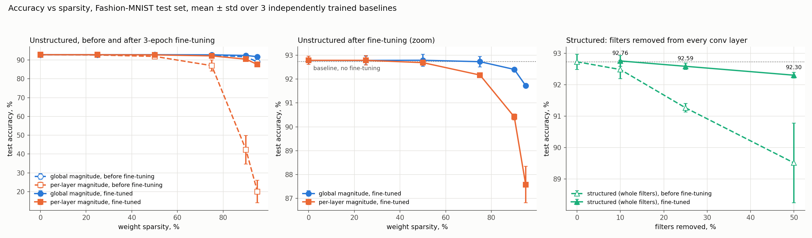
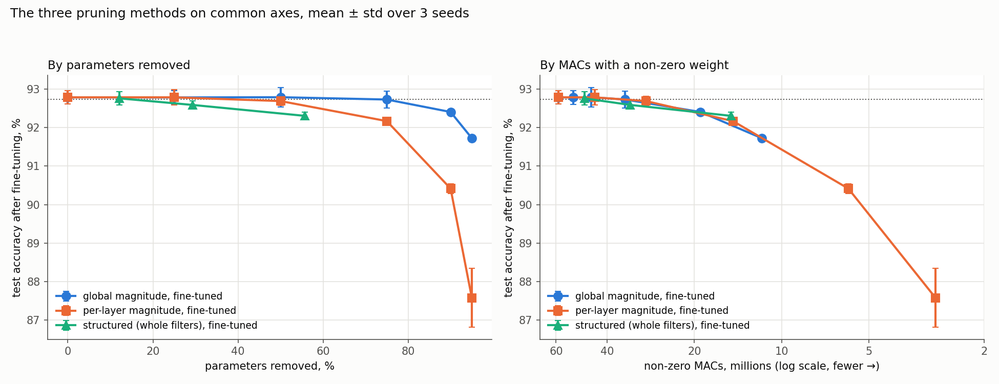
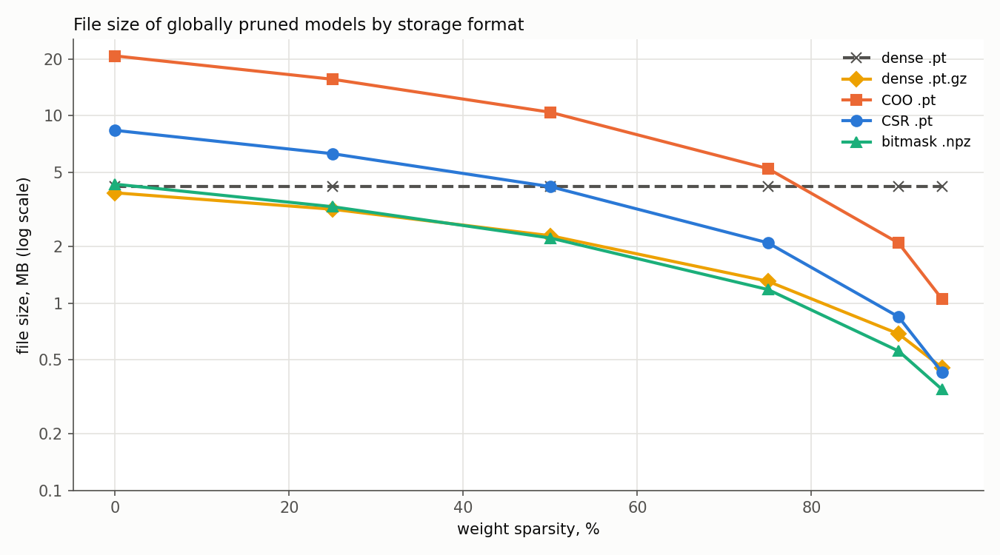
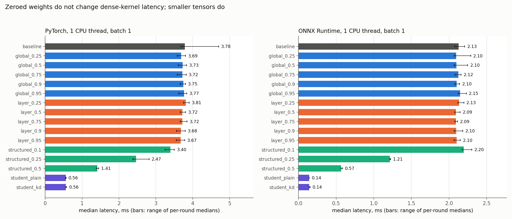
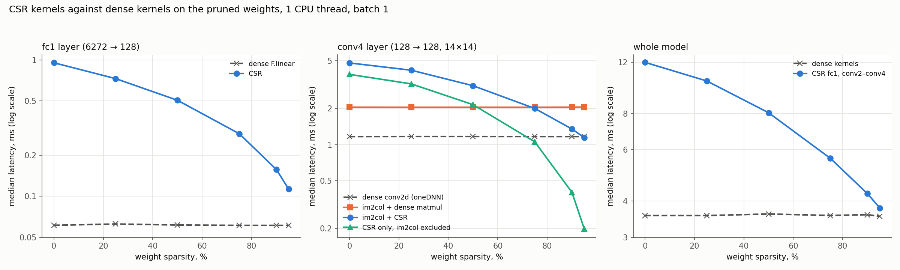
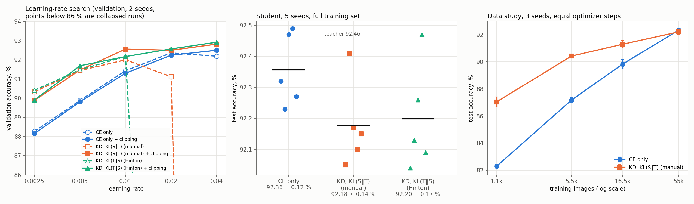
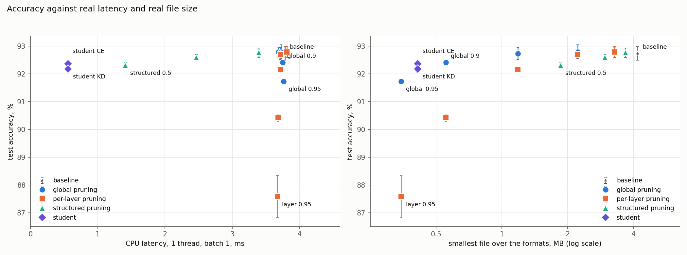

# Lab 7 — Compression: pruning and distillation

## 1. Goal

Train an oversized CNN on Fashion-MNIST, make it smaller in three ways (unstructured magnitude
pruning, structured filter pruning, knowledge distillation), and measure what each way really
changes: accuracy, file size, latency, compute and energy.

| Learning outcome | Evidence in this report |
|---|---|
| Apply global, layer-wise and structured pruning at controlled sparsity | §3.2; `results/prune_study.txt`, `sparsity_curves.png` |
| Distinguish storage reduction from real latency improvement | §3.3; `results/storage.txt`, `latency.txt`, `sparse_kernels.txt` |
| Train a compact student with knowledge distillation | §3.4; `results/distill.txt` |
| Compare all models across accuracy, size, latency, compute and energy | §3.5; `results/summary.md` |

## 2. Method

**Hardware.** AMD Ryzen 7 2700X (8 cores / 16 threads), 16 GB RAM, NVIDIA GeForce GTX 1060 3 GB,
Windows 10 Pro 19045. Normal desktop programs (browser, messengers) were open during all
measurements.

**Software.** The pinned course environment of the root README: Python 3.11.8, torch 2.3.1 and
torchvision 0.18.1 in their CUDA 12.1 build, onnxruntime 1.18.0. `pynvml` comes in with codecarbon.

**Data.** Fashion-MNIST as in Lab 6: normalize (0.2860, 0.3530), 55 000 / 5 000 train/validation
split (seed 42), official 10 000 test images. All images are kept as tensors on the GPU, with no
augmentation.

**Statistics.** The baseline is trained with 3 seeds (42, 43, 44), and every pruning experiment is
repeated on each of the 3 baselines. Students are trained with 5 seeds (42–46). Tables give
mean ± standard deviation over seeds. Sizes, latency and energy are measured on the seed-42 models.
The sampling error of the test set itself is about 0.27 pp at 92 % (10 000 images).

| File | Step | What it does |
|---|---|---|
| `config.yaml` | — | all settings |
| `src/common.py`, `data.py`, `models.py`, `engine.py`, `bench.py`, `zoo.py` | — | config, tensors, both CNNs and MAC counts, training loop and NVML meter, latency harness, loading of saved models |
| `src/train_baseline.py` | 1 | baseline, 3 seeds |
| `src/prune.py`, `prune_study.py`, `plot_prune.py` | 2 | masks, filter removal, pruning runs, curves |
| `src/storage.py` | 3 | file size in five formats, with a bit-exact round-trip check |
| `src/latency.py` | 3 | latency of 16 models on CPU, ONNX Runtime and GPU |
| `src/sparse_kernels.py` | 3 | CSR kernels against dense kernels |
| `src/tune_distill.py`, `collapse_diag.py` | 4 | learning-rate search, diagnosis of collapsed KD runs |
| `src/distill.py`, `plot_distill.py` | 4 | students with and without teacher, data study |
| `src/energy.py`, `summary.py` | 5 | GPU energy, final table |

Run from the repository root, in this order:

```bash
python lab07/src/train_baseline.py            # ~7 min
python lab07/src/prune_study.py               # ~20 min
python lab07/src/plot_prune.py
python lab07/src/tune_distill.py              # ~15 min, without clipping
python lab07/src/collapse_diag.py
python lab07/src/tune_distill.py --clip 5.0   # ~15 min
python lab07/src/distill.py                   # ~17 min
python lab07/src/plot_distill.py
python lab07/src/storage.py
python lab07/src/latency.py
python lab07/src/sparse_kernels.py
python lab07/src/energy.py                    # ~11 min
python lab07/src/summary.py
```

Checkpoints go to `data/lab07_ckpt/` (git-ignored).

## 3. Results

### 3.1 Oversized baseline [15]

`results/baseline.{txt,csv}`. Conv(1→32) → Conv(32→64) → MaxPool → Conv(64→128) → Conv(128→128) →
MaxPool → Linear(6272→128) → Dropout 0.5 → Linear(128→10), all convolutions 3×3 with padding 1, ReLU
after every layer except the last, no batch norm. SGD lr 0.02, momentum 0.9, weight decay 5e-4, cosine
decay, 15 epochs, batch 128.

| quantity | value |
|---|---|
| test accuracy (seeds 42 / 43 / 44) | 92.46 / 92.81 / 92.92 %, mean **92.73 ± 0.24 %** |
| parameters | **1 044 490** (1 044 000 weights + 490 biases) |
| MACs per image | 58.83 M (own count = thop) |
| file size | **4.18 MB** (float32 `state_dict`) |
| latency, batch 1 | CPU 1 thread **3.66 ms**, CPU 8 threads 2.06 ms, GPU 0.86 ms (median of 5 × 200 runs) |
| training | 130–137 s, 14.1–14.7 kJ of GPU energy |

(The latency of the baseline in the 16-model comparison of §3.3 is 3.78 ms: another run of the same model.)

Where the weights are and where the work is are two different places:

| layer | weights | share of weights | MACs | share of MACs |
|---|---|---|---|---|
| conv1 | 288 | 0.0 % | 0.23 M | 0.4 % |
| conv2 | 18 432 | 1.8 % | 14.45 M | 24.6 % |
| conv3 | 73 728 | 7.1 % | 14.45 M | 24.6 % |
| conv4 | 147 456 | 14.1 % | 28.90 M | 49.1 % |
| fc1 | 802 816 | **76.9 %** | 0.80 M | **1.4 %** |
| fc2 | 1 280 | 0.1 % | 0.00 M | 0.0 % |

This explains most of the results below: fc1 holds the storage, and the convolutions hold the time.

### 3.2 Pruning [35]

`results/prune_study.txt`, `prune_summary.csv`, `prune_runs.csv`.

* **Global**: the weights of all layers are ranked together by absolute value and the smallest are set
  to zero. **Per-layer**: the same sparsity in every layer. Biases are never pruned.
* **Fine-tuning**: 3 epochs, SGD lr 0.005 with cosine decay. The mask is applied again after every
  optimizer step, and after training the script asserts that every masked weight is still exactly 0.
* **Structured**: in each conv layer the filters with the smallest L2 norm (10 / 25 / 50 %) are
  **physically removed**, together with the matching input channels of the next layer (for conv4, 49
  columns of fc1 per filter). As a check, the rebuilt network gives the same logits as the original
  with those filters zeroed (largest difference 7.6e-6, float32 rounding).
* **Control**: sparsity 0 is also fine-tuned for 3 epochs, so the effect of extra training can be seen.

| method | target | params removed | non-zero MACs, M | test before fine-tuning, % | test after, % | change vs baseline, pp |
|---|---|---|---|---|---|---|
| global / layer | 0 | 0 % | 58.83 | 92.73 ± 0.24 | 92.78 ± 0.17 | +0.05 ± 0.08 |
| global | 25 % | 25 % | 52.32 | 92.69 ± 0.27 | 92.78 ± 0.18 | +0.05 ± 0.06 |
| global | 50 % | 50 % | 45.47 | 92.71 ± 0.19 | 92.79 ± 0.25 | +0.06 ± 0.05 |
| global | 75 % | 75 % | 34.64 | 92.61 ± 0.13 | 92.73 ± 0.22 | −0.00 ± 0.04 |
| global | **90 %** | 90 % | 19.05 | 91.63 ± 0.27 | **92.40 ± 0.07** | −0.33 ± 0.19 |
| global | 95 % | 95 % | 11.70 | 89.00 ± 1.06 | 91.72 ± 0.06 | −1.01 ± 0.23 |
| per-layer | 25 % | 25 % | 44.12 | 92.63 ± 0.19 | 92.78 ± 0.20 | +0.05 ± 0.06 |
| per-layer | 50 % | 50 % | 29.42 | 91.89 ± 0.61 | 92.69 ± 0.12 | −0.04 ± 0.12 |
| per-layer | 75 % | 75 % | 14.71 | 86.99 ± 2.97 | 92.17 ± 0.09 | −0.56 ± 0.21 |
| per-layer | 90 % | 90 % | 5.88 | 42.31 ± 7.56 | 90.42 ± 0.13 | −2.31 ± 0.36 |
| per-layer | 95 % | 95 % | 2.94 | 20.06 ± 5.98 | 87.58 ± 0.76 | −5.15 ± 0.98 |
| structured | 10 % filters | 12.2 % | 47.89 | 92.48 ± 0.29 | 92.76 ± 0.17 | +0.03 ± 0.08 |
| structured | 25 % filters | 29.3 % | 33.29 | 91.27 ± 0.13 | 92.59 ± 0.10 | −0.14 ± 0.14 |
| structured | 50 % filters | 55.7 % | 14.97 | 89.51 ± 1.27 | 92.30 ± 0.09 | −0.43 ± 0.21 |



* **Up to 50 % nothing is lost** with either unstructured method, and global pruning loses nothing up
  to 75 %. The model really is oversized.
* **Global beats per-layer at the same sparsity, and the gap grows** (90 %: 92.40 vs 90.42 %; 95 %:
  91.72 vs 87.58 %). Global pruning takes the weights mostly from fc1. At 90 % (seed 42) it removes
  95 % of fc1 but only 6 % of conv1, 44 % of conv2, 64 % of conv3 and 82 % of conv4. Per-layer
  pruning takes 90 % everywhere, so conv1 keeps 29 of 288 weights, and before fine-tuning the network
  is destroyed (42 %).
* **Fine-tuning repairs most of the damage**: per-layer 90 % goes from 42 to 90 %, structured 50 %
  from 89.5 to 92.3 %.
* **The comparison depends on the axis.** Per parameter removed, structured pruning looks worst, because
  filters are removed evenly from every conv layer, and most parameters are in fc1. Per MAC that is
  still needed, the three methods lie on nearly **the same curve** (right plot):



  At ~15 M non-zero MACs, per-layer 75 % has 92.17 % and structured 50 % has 92.30 %. So the "better"
  accuracy of global pruning is bought by keeping the conv weights, which are the expensive ones: at
  90 % sparsity it still needs 32 % of the MACs.

### 3.3 Storage and latency [15]

**File size.** `results/storage.txt`. Fine-tuned seed-42 models, saved in five formats. Every file was
loaded back and is bit-identical to the original weights. Sizes in MB:

| model | dense .pt | dense .pt.gz | COO .pt | CSR .pt | bitmask .npz |
|---|---|---|---|---|---|
| baseline | 4.18 | 3.88 | 20.89 | 8.36 | 4.31 |
| global 50 % | 4.18 | 2.29 | 10.45 | 4.19 | 2.23 |
| global 75 % | 4.18 | 1.31 | 5.23 | 2.10 | 1.18 |
| global 90 % | 4.18 | 0.69 | 2.09 | 0.84 | **0.55** |
| global 95 % | 4.18 | 0.45 | 1.05 | 0.43 | **0.35** |
| filters −50 % | 1.86 | 1.72 | 9.26 | 3.71 | 1.91 |
| student | 0.41 | 0.38 | 2.05 | 0.82 | 0.43 |



* **A dense file does not get smaller by pruning at all**: zeros are stored like any other float32
  (4.18 MB at every sparsity).
* A sparse format has to pay for the positions. COO needs 2 int64 + 1 float32 = 20 B per non-zero, so
  it is smaller than dense only above 80 % sparsity. CSR with int32 columns needs 8 B and breaks even at
  50 %. A bitmask needs 1 bit per weight plus 4 B per non-zero. It is smaller than dense from 25 % on and the
  smallest of all five from 50 % on (at 25 % plain gzip is slightly smaller). PyTorch's default COO is
  therefore a bad storage format.
* At 90 % the best format gives **7.5×** smaller files, and at 95 % **12.1×**. The student needs no
  special format at all: 0.41 MB, 10.1× smaller than the baseline.

**Latency.** `results/latency.txt`. 16 models, batch 1, 5 rounds × 200 timed runs after 100 warm-up runs
in every round; the models are measured in a new random order in each round, so that slow drifts of
the machine hit all of them. Median latency in ms (speed-up over the baseline):

| model | CPU 1 thread | CPU 8 threads | ONNX Runtime, 1 thread | GPU | GPU, batch 256 |
|---|---|---|---|---|---|
| baseline | 3.78 | 2.16 | 2.13 | 0.83 | 11.45 |
| global 50 % | 3.73 (1.01×) | 2.15 (1.01×) | 2.10 (1.01×) | 0.87 (0.95×) | 11.51 (0.99×) |
| global 90 % | 3.75 (1.01×) | 2.19 (0.99×) | 2.10 (1.01×) | 0.84 (0.99×) | 11.50 (1.00×) |
| per-layer 95 % | 3.67 (1.03×) | 2.08 (1.04×) | 2.10 (1.01×) | 0.84 (0.99×) | 11.51 (0.99×) |
| filters −10 % | 3.40 (1.11×) | 1.92 (1.13×) | 2.20 (0.97×) | 0.83 (1.00×) | 10.74 (1.07×) |
| filters −25 % | 2.47 (1.53×) | 1.42 (1.52×) | 1.21 (1.75×) | 0.83 (1.00×) | 10.03 (1.14×) |
| filters −50 % | **1.41 (2.68×)** | 1.06 (2.05×) | **0.57 (3.75×)** | 0.89 (0.94×) | 5.38 (2.13×) |
| student (102 k) | **0.56 (6.8×)** | 0.55 (3.9×) | **0.14 (14.9×)** | 0.69 (1.2×) | 2.03 (5.6×) |



* **Unstructured pruning gives no speed-up at any sparsity**: 0.95–1.06× on every device and
  runtime, including 95 % zeros (2.94 M of 58.83 M non-zero MACs). These differences are within the
  spread of the per-round medians (for the baseline on 1 thread, 3.69–4.70 ms).
* **Physically smaller tensors are faster.** Removing 50 % of the filters leaves 25 % of the MACs and
  gives 2.7× in PyTorch, 3.75× in ONNX Runtime. The gain is smaller than the MAC ratio (3.9×) in PyTorch
  because part of the time (layer calls, pooling, copies) does not shrink.
* The student has 20× fewer MACs but is only 6.8× faster in PyTorch, because a 0.56 ms run is dominated
  by fixed overhead. ONNX Runtime, with less overhead per layer, reaches 14.9×.
* Filters −10 % is 1.11× faster in PyTorch but **slower in ONNX Runtime (0.97×)**. The widths 29, 58 and
  115 are not multiples of 8, while 24/48/96 and 16/32/64 are. ORT's blocked convolution layout works on
  multiples of 8 channels, so this is the likely cause (not profiled). Filter counts should be
  rounded to the vector width.
* On the **GPU at batch 1** nothing helps except the smallest model: 0.83 ms is mostly kernel launches.
  At batch 256 the time is set by the MACs again (filters −50 %: 2.13×, student: 5.6×).

**Why unstructured sparsity rarely speeds up dense CPU kernels.**

1. *The kernel never looks at the values.* oneDNN and MKL multiply packed blocks of weights with SIMD
   instructions (8 floats at once). A zero weight costs the same as any other, and no branch skips it.
2. *Skipping would cost more than it saves.* Checking each weight breaks vectorization: one mispredicted
   branch costs tens of cycles, one multiply-add a fraction of a cycle.
3. *Sparse formats add work*: an index must be loaded for every non-zero, and the input is read at
   irregular addresses, so caches, prefetching and SIMD gather work badly.
4. *Amdahl.* In this model the zeros are mostly in fc1 (77 % of the weights), which does only 1.4 % of
   the MACs.

Point 3 was measured with `sparse_kernels.py` (1 thread, per-layer pruned weights, median ms):

| sparsity | fc1 dense | fc1 CSR | conv4 dense | conv4 im2col + CSR | conv4 CSR only | whole model, dense | whole model, CSR |
|---|---|---|---|---|---|---|---|
| 0 % | 0.061 | 0.954 | 1.167 | 4.803 | 3.854 | 3.56 | 12.00 |
| 50 % | 0.062 | 0.506 | 1.169 | 3.101 | 2.155 | 3.61 | 8.05 |
| 75 % | 0.061 | 0.288 | 1.168 | 2.002 | 1.055 | 3.56 | 5.61 |
| 90 % | 0.061 | 0.157 | 1.167 | 1.351 | 0.401 | 3.59 | 4.24 |
| 95 % | 0.061 | 0.113 | 1.167 | 1.145 | 0.198 | 3.54 | 3.78 |



The CSR kernels do get faster with sparsity, so sparsity is not useless. But for fc1 CSR is slower than
the dense kernel even at 95 % (0.11 vs 0.06 ms). For conv4 the CSR product alone beats the dense
kernel from about 75 % on and is 5.9× faster at 95 %, but the im2col step that it needs costs about
0.95 ms, so the complete layer only reaches the dense speed at 95 % (1.145 vs 1.167 ms). For the **whole model
CSR is slower at every sparsity** (3.78 vs 3.54 ms at 95 %). A speed-up from unstructured sparsity
needs either hardware and kernels made for it or a much higher sparsity in the layers that hold the
time.

### 3.4 Knowledge distillation [30]

`results/distill.txt`, `distill_runs.csv`, `tune_distill*.txt`, `collapse_diag.txt`.

Teacher: baseline seed 42 (92.46 % test, 96.0 % train). Student: Conv(1→16) → MaxPool → Conv(16→32) →
Conv(32→32) → MaxPool → Linear(1568→56) → Linear(56→10), **102 482 parameters** (10.2× fewer), 2.91 M MACs
(20.2× fewer). T = 4, α = 0.5, 15 epochs. Teacher logits are precomputed once on the training set
(no augmentation). For one seed, all variants start from the same weights and see the same batches.

**The formula.** The manual's loss contains KL(softmax(student/T) ‖ softmax(teacher/T)). This is the
reverse of the direction in Hinton's paper and in `F.kl_div(log_softmax(student), softmax(teacher))`,
which compute KL(teacher ‖ student). The variant `kd` follows the manual literally. `kd_forward` uses
Hinton's direction, as a check.

**First attempt, kept as evidence** (`results/distill_lr0.02_first_run.txt`). With the student at the
baseline's lr 0.02, no clipping and the same setting for all variants, the KD loss was unstable: seed 45
collapsed to 10 % (random), seed 43 got 88.6 %, and KD looked much worse than plain training
(test 74.5 ± 36 % vs 91.9 ± 0.2 %). A short diagnosis
(`collapse_diag.py`) replays the first 3 epochs at lr 0.02: around step 30 the gradient norm spikes
to 133 (`kd`, seed 45) and 248 (`kd_forward`, seed 7), but only 22 for plain CE. After the spike,
54–70 % of the fc1 ReLU units are dead on the validation set from step 200 on (23–43 % for plain CE;
34–38 % for `kd_forward` seed 8, which had the smallest KD spike, 36, and survived in the search). The collapse itself did
not occur in the replay (the replay has a constant lr and is chaotic), so this is consistent with the
cause, but does not prove it. The T² factor multiplies the KL gradient by 16, so early training is much
more violent than with plain CE.

**Fix and search, the same for all variants.** Gradient norm clipped at 5.0, and the lr chosen for each
variant on the **validation set** with seeds 7 and 8, which are not used afterwards, over
{0.0025, 0.005, 0.01, 0.02, 0.04}. In total 30 runs without and 30 runs with clipping; the clipping value
5.0 was fixed in advance and not tuned. Result: lr **0.04 for all three variants** (validation 92.50 %
plain, 92.82 % kd, 92.92 % kd_forward). Without clipping the KD variants had failed runs at lr ≥ 0.02; with
clipping there were none. The best lr is at the edge of the grid, so it may not be optimal for any
variant. I had seen the test accuracies of the first attempt before making this change; the choice
itself used only the validation set.

**Student with and without the teacher** (5 seeds, full training set):

| variant | train, % | val, % | **test, %** | test CE | agreement with teacher, % |
|---|---|---|---|---|---|
| plain student (CE only) | 97.23 ± 0.14 | 92.60 ± 0.24 | **92.36 ± 0.12** | 0.2364 ± 0.0048 | 94.82 |
| KD, KL(S‖T) (manual) | 95.56 ± 0.10 | 92.92 ± 0.18 | **92.18 ± 0.14** | 0.2291 ± 0.0042 | 96.64 |
| KD, KL(T‖S) (Hinton) | 95.65 ± 0.18 | 92.92 ± 0.19 | **92.20 ± 0.17** | 0.2273 ± 0.0031 | 96.68 |
| *teacher (seed 42)* | *96.01* | *93.16* | *92.46* | *0.2155* | |

Size and latency (identical for all variants because the network is the same): 0.41 MB, 0.56 ms on one
CPU thread, against 4.18 MB and 3.78 ms for the teacher.

**Distillation did not help on the full data set.** Paired difference in test accuracy, KD − plain:
−0.18 ± 0.22 pp (per seed −0.27 / +0.18 / −0.30 / −0.39 / −0.12, t = −1.80; not significant, critical
value 2.78). For Hinton's direction −0.16 ± 0.10 pp (t = −3.51), which is nominally significant but
only reflects training randomness; the test set sampling error is 0.27 pp. On the validation set the
sign is the opposite (+0.32 pp), so the honest conclusion is **no measurable difference in accuracy**.
The two KL directions do not differ either (−0.02 ± 0.24 pp).

Reasons, and what KD did change:

* There is almost nothing to distill. The plain student (92.36 %) is already at the level of the
  teacher (92.46 %), so a 10× larger network brings only 0.1 pp on this data set.
* KD acts as a regularizer: training accuracy drops from 97.2 to 95.6 %, test CE improves from 0.236 to
  0.229 (better probabilities), and the student agrees with the teacher more often (94.8 → 96.6 %). It also
  inherits the teacher's mistakes.
* McNemar test for seed 42 (KD vs plain): 198 images only KD gets right, 225 only plain gets right, χ² = 1.60
  (3.84 needed) — no difference.

**Where KD does help: little data.** Both variants train on a random fraction of the training set (3 seeds) with
the same number of optimizer steps as 15 full epochs, so the compute is equal.

| training images | plain student, % | KD student, % | KD − plain, pp |
|---|---|---|---|
| 1 100 (2 %) | 82.29 ± 0.11 | **87.05 ± 0.37** | **+4.75 ± 0.27** |
| 5 500 (10 %) | 87.18 ± 0.18 | **90.43 ± 0.14** | **+3.24 ± 0.06** |
| 16 500 (30 %) | 89.84 ± 0.35 | 91.30 ± 0.27 | +1.46 ± 0.60 |
| 55 000 (100 %) | 92.34 ± 0.12 | 92.21 ± 0.18 | −0.13 ± 0.27 |



With 1 100 images KD gives +4.75 pp, because the soft targets carry information about how similar the classes
are that hard labels do not contain. One caveat: the teacher has seen all 55 000 labels. The gain means
"cheap adaptation of a student with few *own* labels when a good teacher exists", not "few labels in total".

### 3.5 Summary by efficiency pillar [20]

`results/summary.md`, `energy.txt`. Accuracy: mean over seeds. Sizes, latency and energy: seed-42 models.
"incl. teacher / pre-training" adds the cost of the baseline to the pruned models and to the distilled
student, because neither can exist without it.

| pillar | metric | baseline (teacher) | global 90 % | per-layer 90 % | filters −25 % | filters −50 % | student, CE | student, KD |
|---|---|---|---|---|---|---|---|---|
| **data** | labelled training images | 55 000 | 55 000 | 55 000 | 55 000 | 55 000 | 55 000 | 55 000 |
| | image passes, own training (k) | 825 | 165 | 165 | 165 | 165 | 825 | 825 |
| | image passes, incl. teacher / pre-training (k) | 825 | 990 | 990 | 990 | 990 | 825 | 1 705 |
| | test acc with only 1 100 images, % | — | — | — | — | — | 82.29 ± 0.11 | **87.05 ± 0.37** |
| **model** | test accuracy, % | 92.73 ± 0.24 | 92.40 ± 0.07 | 90.42 ± 0.13 | 92.59 ± 0.10 | 92.30 ± 0.09 | 92.36 ± 0.12 | 92.18 ± 0.14 |
| | parameters | 1 044 490 | 1 044 490 | 1 044 490 | 738 794 | 463 050 | 102 482 | 102 482 |
| | non-zero parameters | 1 044 490 | 104 890 | 104 891 | 738 794 | 463 050 | 102 482 | 102 482 |
| | file, dense, MB | 4.18 | 4.18 | 4.18 | 2.96 | 1.86 | 0.41 | 0.41 |
| | file, best sparse format, MB | 4.31 | 0.56 | 0.56 | 3.05 | 1.92 | 0.43 | 0.43 |
| **compute** | MACs executed by dense kernels, M | 58.83 | 58.83 | 58.83 | 33.29 | 14.97 | 2.91 | 2.91 |
| | MACs with a non-zero weight, M | 58.83 | 18.74 | 5.88 | 33.29 | 14.97 | 2.91 | 2.91 |
| | CPU 1 thread, batch 1, ms | 3.78 | 3.75 | 3.68 | 2.47 | 1.41 | **0.56** | **0.56** |
| | CPU 8 threads, batch 1, ms | 2.16 | 2.19 | 2.15 | 1.42 | 1.06 | 0.55 | 0.54 |
| | ONNX Runtime 1 thread, batch 1, ms | 2.13 | 2.10 | 2.10 | 1.21 | 0.57 | **0.14** | **0.14** |
| | GPU batch 1, ms | 0.83 | 0.84 | 0.84 | 0.83 | 0.89 | 0.69 | 0.69 |
| | GPU training time incl. teacher, s | 134 | 160 | 160 | 155 | 149 | **29** | 164 |
| **energy** | GPU training energy incl. teacher, kJ | 14.5 | 17.2 | 17.2 | 16.7 | 15.9 | **2.6** | 17.1 |
| | GPU inference, batch 256, mJ/image | 5.02 | 4.98 | 4.81 | 4.40 | 2.42 | **0.86** | **0.83** |
| | GPU inference, batch 1, mJ/image | 33 | 29 | 29 | 32 | 37 | 19 | 20 |
| | CPU inference, upper bound (TDP 105 W × latency), mJ/image | 227 | 230 | 226 | 149 | 111 | 58 | 57 |



How the energy was measured:

* Training: mean sampled GPU power × time (20 ms sampling), which agrees with the NVML total-energy counter of the
  GTX 1060 to within 0.1 %. Inference: the NVML counter over 10 s of synchronized runs after a 3 s warm-up,
  3 repeats in shuffled order. Idle power is 11 W; all values are gross (idle included).
* **Batch 1 is not reliable.** The standard deviation between repeats is 5–10 mJ for several models (for example
  baseline 33 ± 7, student 19 ± 10), because at that load the card moves between power states. The differences between the
  large models there are not meaningful. Batch 256 is stable (± 1–2 %).
* The small drop of pruned models at batch 256 (5.02 → 4.98 and 4.81 mJ) is not a benefit that the
  latency supports (batch-256 times are equal within 1 %; in the energy run the throughput differed by 3 %, which the latency
  run did not show), so no saving is claimed.
* CPU energy could not be measured (no RAPL access on this machine). The row is TDP × latency,
  an upper bound, proportional to latency by construction. It carries no information beyond the latency row.

**Conclusion**

1. **Pruning weights is a storage technique, not a speed technique, on normal hardware.** Global pruning to
   90 % makes the file 7.5× smaller (4.18 → 0.56 MB in a bitmask format) for −0.33 pp, and to 75 % for no
   loss, but with dense kernels the latency and the energy per inference do not change. Even a real
   CSR implementation is slower than the dense one for the whole model.
2. **Structured pruning is the pruning method that also helps compute and energy**: filters −50 % cost
   −0.43 pp and give 2.7× lower CPU latency and 2.1× lower GPU energy per image at batch 256, with
   55.7 % fewer parameters.
3. **A small model from scratch beats both here.** A 102 k student reaches 92.36 % (−0.37 pp vs the baseline mean,
   about the same as global 90 % with 105 k non-zeros) with 6.8× lower CPU latency, 10× smaller files, 5.8×
   lower GPU inference energy, and 5.6× lower *training* energy (2.6 vs 14.5 kJ). At about equal accuracy (global 90 %, filters −50 %) it is
   better on every axis measured. The baseline was not tuned (one lr, fixed in advance), while the
   students got an lr search, so this comparison favours the students slightly.
4. **Distillation brought nothing on the full data set** (difference −0.18 ± 0.22 pp) because the teacher is only
   0.1 pp better than the plain student, and it costs 2.7 kJ (plus 0.3 kJ for the teacher logits) on top of the 14.5 kJ for the teacher (6.6× the
   energy of the plain student). Its value is in the data pillar: with 2 % of the training images it
   gives +4.75 pp.
5. **The right tool depends on the bottleneck.** If storage or download size is the limit: global
   pruning with a bitmask or CSR format. If latency or energy is the limit: structured pruning or a small
   dense model. If labelled data is the limit and a good teacher exists: distillation.
6. A MAC count is not a latency, a parameter count is not a file size, and a zero in a dense tensor is neither.
   All three had to be measured.

Limits: one data set that is easy for a small CNN; the KD result may differ when the teacher is clearly
better than the student. Structured pruning used the same fraction in every layer; the common alternative
(global ranking of filters) was not tried. One CPU and one GPU. 3 and 5 seeds.
